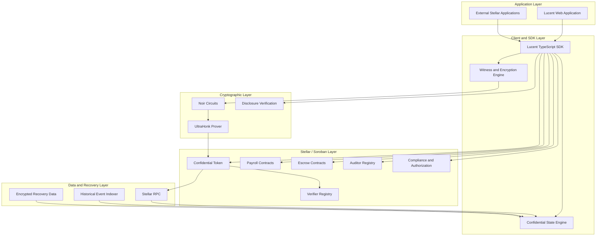
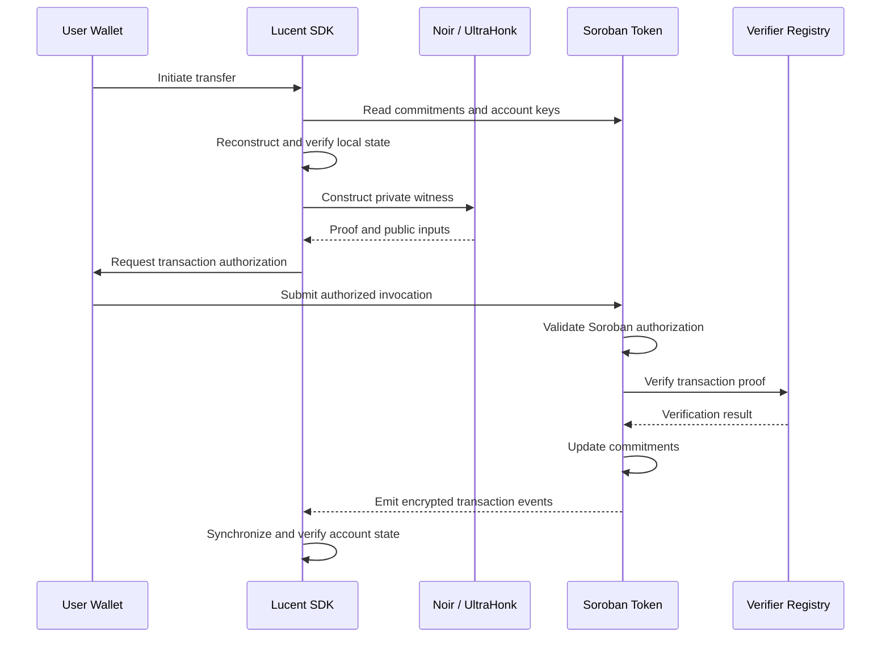
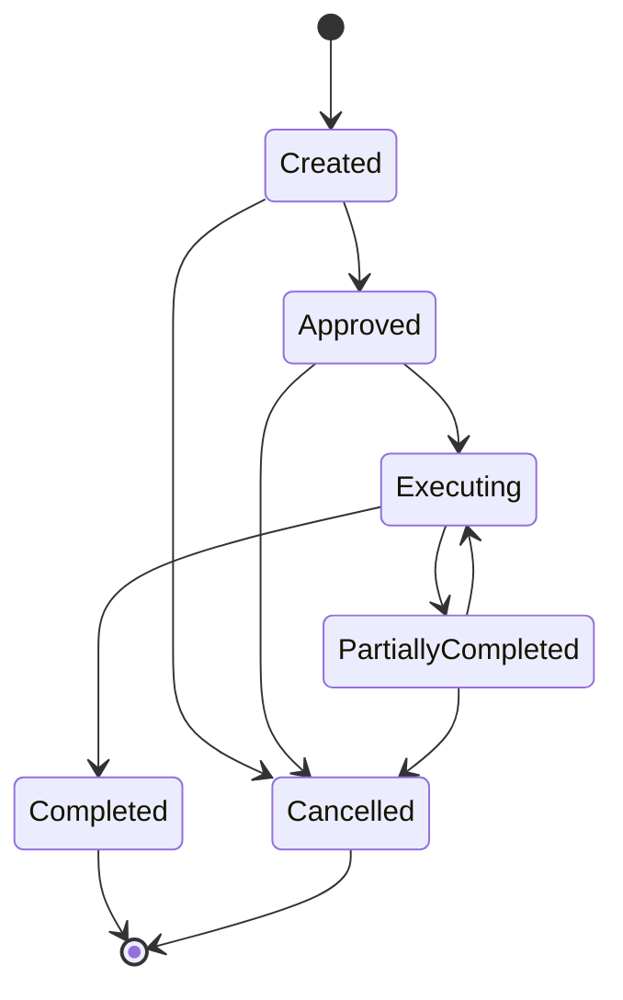
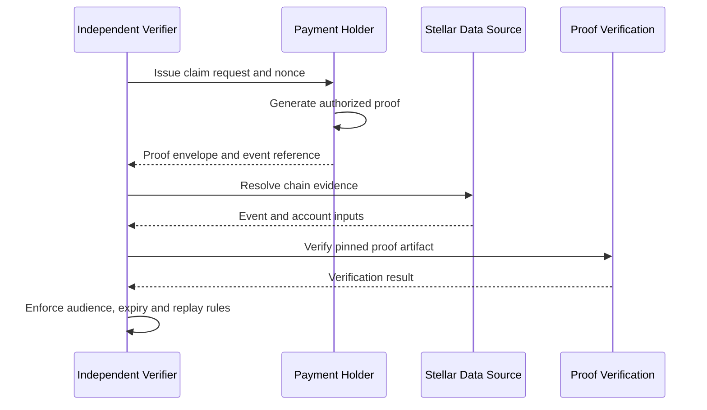

# Lucent Technical Architecture

**Confidential Payments & Verifiable Financial Infrastructure on Stellar**

**Network:** Stellar Testnet  
**Implementation reference:** [ToluLabs/Lucent](https://github.com/ToluLabs/Lucent/tree/00c2270)  
**Architecture baseline:** November 10, 2026  
**Status:** Experimental implementation with proposed architectural extensions

---

## 1. System Overview

### 1.1 Introduction

Lucent is a privacy-preserving payment protocol built on Stellar. It enables confidential-value transfers, verifiable settlement, programmable financial operations, and selective disclosure using Soroban smart contracts and zero-knowledge cryptography.

The protocol is designed around a fundamental distinction: **the validity of a financial transaction should be independently verifiable without requiring its amount to be publicly disclosed.**

Lucent combines four primary capabilities:

- **Confidential accounting:** Pedersen commitments represent account balances and transaction amounts.
- **Zero-knowledge verification:** Cryptographic proofs establish the validity of supported payment operations without revealing private witnesses.
- **Programmable settlement:** Soroban contracts enforce transaction authorization, accounting rules, and payment workflows.
- **Selective disclosure:** Authorized parties can verify specific transaction facts without accessing unrelated confidential financial information.

The current implementation provides the foundation for confidential payments, payroll, escrow, auditor access, and transaction-specific disclosure.

The proposed architecture extends these capabilities into recoverable payment infrastructure, organizational financial controls, programmable verification, and reusable developer interfaces.

### 1.2 Architecture principles

Lucent's design follows six principles.

**Confidentiality by construction**

Supported transaction amounts and confidential balances are represented through cryptographic commitments and encrypted event data rather than publicly readable account balances.

**Verifiable state transitions**

A confidential balance update must satisfy the constraints of its corresponding zero-knowledge proof and the authorization requirements of the executing Soroban contract.

**Separation of proof and authority**

Possession of a valid cryptographic witness or proof does not independently grant permission to spend funds.

**Non-custodial client operations**

Private witnesses and payment secrets are prepared on the client where supported. Infrastructure services should not require unrestricted access to users' spending secrets.

**Recoverable and observable execution**

The system must provide sufficient authenticated transaction history, execution status, and failure reporting to reconstruct supported account state and reconcile financial operations.

**Composable developer infrastructure**

Confidential payment and verification functionality should be exposed through documented interfaces that can be integrated into other Stellar applications.

### 1.3 System architecture

Lucent is organized into five interacting layers.



The application and SDK construct transactions and private witnesses.

The cryptographic layer generates proofs locally and verifies supported disclosure statements.

Soroban contracts authenticate callers, validate proof-carrying operations, and maintain commitment-based financial state.

Historical event infrastructure provides the data required for state reconstruction and recovery.

### 1.4 Implementation boundaries

| Component                    | Existing implementation                                                 | Architectural extension                                   |
| ---------------------------- | ----------------------------------------------------------------------- | --------------------------------------------------------- |
| Confidential payments        | Registration, deposits, confidential transfers, merging and withdrawals | Stronger integration and recovery guarantees              |
| Proof verification           | UltraHonk proving and Soroban verifier infrastructure                   | Additional constrained statements and artifact governance |
| Payroll                      | Employer-authorized multi-recipient execution                           | Bounded, resumable and recurring execution                |
| Escrow                       | Factory, instances and local settlement improvements                    | Compatible contract-controlled settlement                 |
| Account recovery             | Event replay and local state verification                               | Durable historical indexing and encrypted backups         |
| Organizational authorization | Existing employer and registry administration                           | Policy-bound treasury and multi-party approvals           |
| Auditor access               | Public-key registry and encrypted disclosure channels                   | Organization-specific scopes and key epochs               |
| Selective disclosure         | Sender and recipient transaction proofs                                 | Portable payment and invoice proofs                       |
| Developer tooling            | Internal TypeScript SDK                                                 | Stable SDK and independent integrations                   |

The existing implementation is experimental and unaudited. A source-level implementation is not necessarily equivalent to the currently deployed Testnet contract interface.

---

## 2. System Components

### 2.1 Web application

The Next.js application provides the interface for wallet connection, confidential account management, payments, payroll, escrow, and disclosure workflows.

The application integrates with Stellar wallet signing and the Lucent SDK.

Its responsibilities include:

- Wallet connection and transaction approval.
- Confidential account initialization.
- Local witness and transaction preparation.
- Confidential balance reconstruction.
- Transaction submission and confirmation.
- Display of supported settlement and verification results.

The interface is not a trusted authority for financial operations. Authorization-sensitive restrictions must also be enforced by Soroban contracts or cryptographic controls.

### 2.2 TypeScript SDK

Located in `packages/sdk`, the SDK contains the primary client-side protocol implementation.

Its existing modules cover:

- Elliptic-curve and field arithmetic.
- Commitment and encryption utilities.
- Witness construction.
- Zero-knowledge proof generation.
- Soroban transaction encoding.
- RPC interaction.
- Confidential account state management.
- Payroll and escrow operations.
- Auditor decryption.
- Selective disclosure.

The SDK coordinates private witness construction with the public inputs expected by the deployed contracts.

The current SDK is used internally by Lucent. A stable external distribution, compatibility guarantees, and independent integration examples remain architectural extensions.

### 2.3 Cryptographic circuits

Lucent uses Noir circuits with the UltraHonk proving system.

The circuits constrain relationships between confidential values, commitments, keys, ciphertexts, and permitted state transitions.

Proofs are generated off-chain.

The corresponding verification artifacts are consumed either by Soroban verification infrastructure or supported off-chain disclosure verifiers, depending on the operation.

Circuit artifacts, verification keys, and their encoding conventions must remain synchronized across the SDK and deployed contracts.

### 2.4 Soroban contracts

Soroban provides the execution and state-management layer.

The existing contract set includes:

| Contract           | Responsibility                                                  |
| ------------------ | --------------------------------------------------------------- |
| Confidential Token | Commitment-based balances and proof-carrying payment operations |
| Verifier Registry  | Circuit-specific verification-key management and verification   |
| Auditor Registry   | Auditor public-key registration and rotation                    |
| PayrollVault       | Employer-authorized payroll templates and executions            |
| Escrow Factory     | Deployment of escrow instances                                  |
| Escrow Instance    | Conditional settlement and escrow lifecycle                     |
| Compliance Policy  | Administrative policy and compliance-related controls           |

The token implementation builds on a pinned version of OpenZeppelin's experimental Stellar confidential-token functionality.

The token, contracts, SDK, and proving artifacts form a version-dependent protocol. Compatibility must be treated as an explicit architectural requirement.

### 2.5 Historical data infrastructure

The SDK currently retrieves contract events from Stellar RPC and can use an optional indexer for older data.

`packages/indexer` contains a preliminary ingestion pipeline, persistence schema, and query API.

The existing files establish an implementation foundation but do not demonstrate a fully hosted, continuously backfilled historical service.

The proposed recovery architecture turns this into a durable infrastructure component with verified coverage, gap detection, and account-scoped access.

---

## 3. Cryptographic Architecture

### 3.1 Pedersen commitments

Lucent uses Pedersen commitments over Grumpkin to represent confidential amounts and balance values.

For amount \(v\), blinding factor \(r\), and commitment generators \(G\) and \(H\):

\[
C = vG + rH
\]

The public commitment \(C\) conceals the underlying amount while retaining the additive properties needed for confidential accounting.

The security of the construction depends on correctly chosen independent generators, appropriate randomness, correct group arithmetic, and the discrete-logarithm assumptions of the curve.

### 3.2 Confidential account state

A confidential account maintains two primary commitments:

- **Spendable commitment:** Represents the balance available for outgoing confidential operations.
- **Receiving commitment:** Represents incoming confidential value awaiting consolidation.

Deposits and incoming transfers credit receiving.

The merge operation combines receiving into spendable through commitment arithmetic.

Outgoing transfers and withdrawals update the spendable commitment according to the constraints of their proofs.

The client reconstructs the associated balance openings from its confidential keys and transaction history.

The resulting commitments must match Soroban contract state before the client treats the reconstructed balance as verified.

### 3.3 Proof generation

The proof-generation pipeline is:

1. Retrieve the relevant on-chain account commitments and keys.
2. Determine the required private witness.
3. Construct the ordered public-input vector.
4. Execute the corresponding Noir circuit.
5. Generate an UltraHonk proof.
6. Encode the proof and operation arguments.
7. Submit an authorized Soroban invocation.
8. Verify the proof against the registered verification key.

The current prover uses the Keccak transcript required by the verifier backend.

Encoding differences between the SDK, compiled circuit, verification key, and contract are security-sensitive and must cause compatibility validation to fail.

### 3.4 Existing circuit interfaces

The current compiled witness and circuit interfaces expose the following public-input sizes:

| Circuit      | Public field elements | Main constrained information                                                                         |
| ------------ | --------------------: | ---------------------------------------------------------------------------------------------------- |
| Registration |                     5 | Account and viewing-key registration                                                                 |
| Withdrawal   |                    15 | Current and updated commitments, amount, encrypted state and auditor information                     |
| Transfer     |                    24 | Sender commitments, recipient keys, transaction commitment, encrypted amount and auditor ciphertexts |

The token reconstructs relevant public inputs from authenticated contract state.

This prevents the caller from freely choosing state-dependent inputs without matching the current token account configuration.

### 3.5 Confidential transaction encryption

The SDK uses Grumpkin ECDH and domain-separated Poseidon2 masking to construct encrypted event payloads.

Recipient and authorized auditor channels support recovery of designated transaction information.

The implementation must preserve consistency between:

- The encrypted value.
- Its commitment.
- Recipient-specific encryption material.
- Auditor-specific encryption material.
- Public inputs constrained by the proof.

An encrypted field that is not appropriately bound to the proven value can undermine verification and disclosure guarantees.

### 3.6 Verification keys and artifacts

The verifier registry associates circuit types with verification keys.

Current registration and updates are controlled by a manager role.

The architecture therefore depends on secure management of verification-key changes, correct contract configuration, and reliable artifact provenance.

The external integration architecture will use versioned artifact identities, supported circuit mappings, and explicit verification-key pinning.

### 3.7 Selective-disclosure proofs

The existing sender and recipient disclosure circuits enable supported parties to prove and reveal a selected payment fact to an authorized verifier.

The verifier independently resolves relevant Stellar event and account data and reconstructs the required verification inputs.

The holder provides the proof and permitted disclosure material.

A valid disclosure proof establishes only the statement constrained by its circuit.

The existing implementation does not automatically establish broader business claims, consume verification requests, or enforce universal expiry and replay protection.

These properties require additional protocol-level controls.

**Source references**

- [Cryptographic SDK modules](https://github.com/ToluLabs/Lucent/tree/00c2270/packages/sdk/src/crypto)
- [Witness construction](https://github.com/ToluLabs/Lucent/tree/00c2270/packages/sdk/src/witness)
- [Proof generation](https://github.com/ToluLabs/Lucent/blob/00c2270/packages/sdk/src/proving/prover.ts)
- [Disclosure circuits](https://github.com/ToluLabs/Lucent/tree/00c2270/packages/disclosure)
- [Verifier implementation](https://github.com/ToluLabs/Lucent/blob/00c2270/contracts/verifier/src/lib.rs)

---

## 4. Soroban Contract Architecture

### 4.1 Confidential Token

The confidential token manages account registration, deposits, merging, confidential transfers, withdrawals, and relevant authorization requirements.

It stores or references the public commitment state necessary for confidential operations.

Transaction proofs constrain permitted changes to the commitment state.

Soroban authorization remains necessary for owner-controlled and supported delegated operations.

**A valid payment proof does not independently authorize spending.**

The proposed organization and escrow architecture will preserve this distinction.

### 4.2 Verifier Registry

The verifier registry stores verification keys by circuit type and provides proof-verification functionality.

Its manager-controlled configuration represents a security-sensitive administrative capability.

The extended design will introduce explicit compatibility requirements between:

- Circuit version.
- Verification-key identity.
- Contract interface.
- Network and deployment.
- SDK release.

Verification-key governance must be reviewed alongside the underlying cryptographic circuit changes.

### 4.3 Auditor Registry

The existing registry stores auditor public keys indexed by auditor identifiers.

Clients use these keys to create encrypted auditor channels for supported payment operations.

The registry does not currently implement organization-scoped disclosure consent.

The proposed model extends registry configuration and cryptographic binding to organization, purpose, and key epoch.

### 4.4 PayrollVault

The current PayrollVault maintains employer-authorized payroll templates and execution state.

A payroll execution processes an ordered vector of confidential transfers within one atomic transaction.

The employer prepares the required proofs.

The current `fund_run` workflow records employer-related funding state but does not independently reserve tokens or cryptographically guarantee that the full payroll budget has been secured.

The proposed architecture introduces committed payroll manifests, bounded execution, persistent settlement tracking, and policy-bound authorization.

### 4.5 Escrow Factory and Instances

The escrow factory deploys dedicated escrow instances.

Escrow contracts coordinate funded state and permitted settlement outcomes.

The newer checked-in escrow implementation includes payout-preparation and preflight functionality, but its interfaces differ from the currently configured Testnet token and instance artifacts.

The proposed escrow design requires a compatible token, instance, factory, and proof-artifact set.

It will enforce release/refund/dispute decisions through contract authorization and properly bound settlement proofs.

### 4.6 Compliance Policy

The existing compliance components support administrative configuration such as allowlisting and freezing behavior.

These mechanisms are distinct from organizational payment authorization, identity verification, and legal compliance certification.

They must not be treated as substitutes for the proposed treasury and approval controls.

### 4.7 Deployment compatibility

The November 10 implementation audit retrieved configured Testnet contract WASM and inspected selected registry entries.

The verifier, auditor, payroll, escrow factory, and policy artifacts matched their checked-in binary references.

The configured token artifact did not match the current checked-in token binary.

The manifest-recorded escrow-instance artifact also differed from the current implementation.

The configured token lacks the newer `verify_escrow_payout` interface, while the recorded escrow instance uses an older payout-preparation interface.

Consequently, the newer escrow source flow must not be represented as deployed and compatible with the configured contract pair.

Future deployment releases must include reproducible contract and artifact compatibility checks.

[Deployment evidence](https://github.com/ToluLabs/Lucent/blob/main/docs/evidence/scf-46-architecture-audit.json)

---

## 5. Transaction and Data Flows

### 5.1 Confidential transfer

A confidential transfer follows a client-prepared, contract-verified workflow.



The SDK prepares the confidential witness and proof.

The token checks the applicable authorization and proof constraints before updating public commitments.

The recipient reconstructs incoming confidential value using the appropriate private information and event payloads.

### 5.2 Deposits, merges, and withdrawals

**Deposit**

The user deposits a public amount of the supported backing asset into the confidential accounting system.

The deposit amount is public.

The receiving commitment is updated accordingly.

**Merge**

An authorized account operation combines receiving and spendable commitments.

This is a homomorphic accounting transition and does not follow the same proof-generation process as a confidential transfer.

**Withdrawal**

The user prepares a proof constraining the authorized withdrawal and resulting confidential balance.

The withdrawal amount is public.

The Soroban contract validates authorization and the required proof before processing the operation.

### 5.3 Existing payroll execution

The existing payroll workflow creates an ordered series of confidential transfers for an authorized employer.

Each transfer proof depends on the appropriate intermediate account state.

The PayrollVault executes the transfer vector atomically.

The practical number of recipients is limited by actual Soroban transaction and execution resources.

The scalable payroll architecture replaces a single large operation with smaller tracked execution chunks.

### 5.4 Existing selective disclosure

A verifier requests a particular supported payment claim.

The sender or recipient constructs the corresponding disclosure proof.

The verifier independently retrieves the relevant Stellar event data, reconstructs verification inputs, and evaluates the proof against the expected artifact.

This process is off-chain and does not itself require another payment transaction.

### 5.5 Transaction visibility

Lucent protects supported confidential amounts, not all public transaction information.

Visible information may include:

- Sender and recipient addresses.
- Transaction timing.
- Contract invocations.
- Public deposit and withdrawal amounts.
- Payroll participant information.
- Escrow contract state and participants.
- Relevant public event metadata.

This boundary applies to both existing and proposed financial workflows.

---

## 6. Proposed Architecture Extensions

The following specifications describe the planned technical architecture. They build on the existing implementation while introducing new contract state, proof constraints, indexing services, and developer interfaces where required.

### 6.1 Historical indexing and verified account recovery

#### Architecture

The historical data service will ingest relevant successful Stellar contract events from an authenticated historical data source and maintain a durable ordered event store.

Each stored record will retain sufficient identifiers for:

- Network and deployment.
- Contract.
- Ledger and transaction.
- Operation and event ordering.
- Event type and payload version.
- Related confidential account where derivable.

The service will distinguish the highest observed ledger from contiguous verified coverage.

A client requesting historical data will receive coverage information alongside paginated event records.

The SDK will join historical records with recent RPC activity at a checked boundary and reconstruct confidential account state.

Only state that passes the required commitment checks will be accepted for restored spending.

#### Recovery protocol

1. Restore supported confidential keys from the original wallet or authenticated backup.
2. Resolve the relevant contract deployment and historical range.
3. Retrieve historical encrypted events.
4. Validate event ordering, completeness indicators, and payload versions.
5. Combine indexed history with recent RPC events.
6. Reconstruct candidate spendable and receiving openings.
7. Compare both commitments with current Soroban state.
8. Persist verified recovery results or return an explicit failure.

The indexer is an availability dependency, not a trusted authority to set balances.

A matching current commitment does not independently prove the completeness of an activity report.

#### Backup design

Authenticated-encrypted backups will contain supported confidential recovery data and cursors.

They will be bound to the relevant account, network, contract deployment, and schema version.

Backups will be decrypted locally.

A stale backup still requires subsequent transaction history.

Neither historical indexing nor state backups automatically restore a lost underlying Stellar wallet.

### 6.2 Secure confidential escrow settlement

#### Existing architecture

Escrow instances are deployed through a factory and maintain their own conditional settlement state.

The existing source contains a newer funding-preflight flow.

That implementation is not currently compatible with the configured deployed token and escrow-instance interfaces.

The funding client also handles confidential witness material associated with the escrow account.

#### Settlement authorization model

The proposed architecture will make escrow settlement authority explicit.

A compatible token and escrow contract set will bind the following:

- Escrow contract identity.
- Funding commitment.
- Approved recipient.
- Permitted settlement branch.
- Relevant authorization policy.
- Current account commitment.
- Settlement nonce.

The escrow contract will determine the permitted release, refund, dispute, or timeout outcome.

The confidential token will accept only the applicable authorized settlement invocation and valid proof.

All alternate spending or delegation paths must respect the same custody boundary.

The precise need for an additional contract-controlled account mode or dedicated settlement circuit will be resolved through an authorization review. The required security property is fixed: **retained witness material must not permit settlement outside the escrow contract's authorized policy.**

#### Proof requirements

Where an additional settlement proof is necessary, it must establish:

- Conservation of confidential value.
- Correct recipient commitment and encryption.
- Correct auditor ciphertext binding.
- Correspondence with the current escrow commitment.
- Valid settlement branch and nonce.
- Required remaining balance conditions.

The contract must reconstruct or authenticate security-sensitive public inputs rather than trust arbitrary caller-supplied metadata.

#### Failure and recovery behavior

The design will account for:

- Invalid or stale proofs.
- Failed funding.
- Unavailable settlement witnesses.
- Unauthorized release attempts.
- Dispute and timeout races.
- Unexpected incoming credits.
- Duplicate settlement.
- Contract version incompatibility.

Escrow v2 will require a coordinated versioned Testnet deployment. Older instances will not automatically inherit the new authorization guarantees.

### 6.3 Bounded and resumable confidential payroll

#### Payroll manifest

Each payroll run will reference a canonical manifest containing:

- Run identifier.
- Payer or treasury.
- Network and token.
- Authorization policy epoch.
- Recipient/payment commitment root.
- Execution state.

Each recipient payment will correspond to a committed leaf with a unique index.

The commitment construction must avoid exposing low-entropy salary amounts through predictable unsalted hashes.

#### Execution model

The employer or organization authorizes the exact manifest.

The client generates bounded groups of payment proofs against the current confidential balance state.

The payroll contract validates the manifest and relevant recipient membership, tracks executed indices, and rejects duplicate settlement.

Each chunk executes atomically.

The overall payroll run progresses through multiple transactions and is therefore **resumable rather than globally atomic**.

#### State transitions

A proposed run lifecycle is:



Cancellation prevents further unauthorized unpaid execution but cannot reverse transfers already settled on-chain.

Reconciliation must distinguish successful payments, pending payments, failed chunks, and cancelled unpaid entries.

#### Security requirements

The contract must reject:

- Invalid recipient membership.
- Incorrect amount or recipient binding.
- Duplicate payment indices.
- Unauthorized execution.
- Replayed chunks.
- Execution after cancellation.
- Invalid policy versions.

Proof preparation must account for sequential balance changes and cannot assume independent stale commitment proofs can settle concurrently.

### 6.4 Organizational treasuries and enforceable approvals

#### Authorization architecture

The organizational payment system introduces a Soroban treasury or policy contract that controls defined financial operations.

The policy model includes:

- Organization membership.
- Authorized financial roles.
- Approval thresholds.
- Policy versions.
- Payment proposals.
- Proposal expiry.
- Execution nonces.
- Revocation behavior.

A payment proposal commits to the exact operation being authorized.

Relevant fields include network, token, treasury, action type, destination or payment root, policy version, nonce, and expiry.

Approvers authenticate the canonical proposal.

Once the required threshold is satisfied, the treasury authorizes the specific Soroban invocation and consumes the corresponding execution nonce.

#### Confidential approval data

Authorized reviewers must be able to inspect the financial details they approve.

The approval interface will use encrypted manifests or appropriately scoped disclosure material.

Private salary amounts will not be placed in public policy state merely to make approvals convenient.

The contract will enforce the authorized operation independently of the frontend.

#### Security requirements

The system must reject:

- Insufficient approvals.
- Unauthorized approvers.
- Reused or expired proposals.
- Invalid policy versions.
- Revoked roles.
- Mutated payment details.
- Cross-network proposal replay.
- Attempts to bypass treasury authority through direct token spending.

The organization approval system must integrate with the token's existing Soroban authorization rather than replacing it with frontend authorization checks.

### 6.5 Recurring confidential payroll

#### Scheduling architecture

Recurring payroll extends the bounded payroll model with a versioned schedule containing:

- Organization identity.
- Schedule identifier.
- Payroll period.
- Execution window.
- Approved policy or manifest reference.
- Revocation state.
- Consumed-period tracking.

An authorized user or off-chain scheduler detects when a payroll period is due and submits the appropriate transaction.

Soroban validates the period, schedule policy, authorization, and duplicate-execution constraints.

Contracts are not assumed to wake themselves or generate private proofs.

#### Witness handling

The architecture must distinguish scheduling authority from access to confidential spending witnesses.

An unattended executor cannot automatically receive unrestricted spending keys.

The supported implementation must use explicitly authorized bounded proof material or another reviewed witness-access design.

Revocation and expiration must prevent stale authorization from being reused.

#### Execution semantics

A successful period records completed settlement state.

A failed or partially executed period remains visible for reconciliation and permitted retry.

A repeated scheduler invocation must not duplicate completed payments.

### 6.6 Confidential invoicing and reconciliation

#### Invoice representation

The invoicing system introduces versioned encrypted invoice records with:

- Invoice identifier.
- Issuer and payee.
- Network and token.
- Confidential amount commitment.
- Applicable settlement rules.
- Invoice status.
- Payment-evidence reference.

Invoice commitments will use appropriate blinding to avoid guessing attacks against predictable amounts.

#### Settlement verification

An invoice must be associated with an authenticated confidential payment.

The verification statement must bind the relevant payment evidence to the agreed invoice commitment, amount, recipient, and settlement policy.

The current amount-only disclosure proof does not automatically establish invoice-specific settlement.

An additional invoice-bound verification artifact is therefore required.

Where invoice status is stored on-chain, updates must be authenticated through valid authorization or independently verified settlement evidence.

A caller-supplied transaction hash is not sufficient proof.

#### Reconciliation

The application will distinguish:

- Fully matched settlement.
- Partial settlement where supported.
- Unmatched payment.
- Incorrect recipient or token.
- Duplicate settlement evidence.
- Failed or cancelled invoice state.

Accounting exports will expose only the information permitted to the authorized user.

A cryptographic payment proof does not establish that goods were delivered or that an invoice is legally valid.

### 6.7 Organization-scoped auditor encryption

#### Scope model

The proposed audit policy defines a versioned disclosure scope containing:

- Organization identity.
- Disclosure purpose.
- Permitted data type.
- Auditor public key.
- Key epoch.
- Relevant authorization policy.

The transfer client resolves the required scope and constructs the appropriate ciphertext.

The proof must bind the encrypted value and scope to the corresponding confidential payment.

The contract must prevent arbitrary auditor substitution or cross-organization scope reuse.

#### Minimal disclosure

Disclosure channels will distinguish between:

- Transaction amount.
- Applicable balance information.
- Recipient-related opening data.
- Other explicitly authorized financial information.

An amount-only auditor should not automatically receive broader balance or recipient-opening material.

This requires circuit-level and ciphertext-level separation, not merely API filtering.

#### Key rotation

New payments may use the updated authorized key epoch.

Historical ciphertext remains governed by its original encryption keys and access assumptions.

Rotation cannot revoke information previously decrypted or copied.

Migration behavior must account for prepared proofs, existing transactions, and required historical access.

### 6.8 Portable confidential payment verification

#### Verification protocol

Portable verification separates the party holding confidential payment data from the party evaluating a permitted claim.

A verifier issues a request containing the intended claim, audience, supported network, verification context, and a fresh nonce.

The holder constructs the corresponding proof.

The returned artifact includes the relevant payment reference, disclosure role, circuit identity, and request context.

The verifier independently resolves the authoritative Stellar event and account inputs.

It then evaluates the proof against the required pinned verification artifact and applies its expiry and replay policy.



#### Security binding

The implementation must distinguish cryptographically constrained fields from ordinary envelope metadata.

Network, audience, expiry, and business-specific claims require appropriate circuit binding or authenticated verification context.

The verifier must not trust holder-supplied public inputs as authoritative chain state.

An optional SDK verification-key parameter must not become an insecure default in the external integration interface.

#### Verification outcomes

A verifier will accept only supported claims under the expected circuit and request policy.

It must reject wrong-chain evidence, substituted events, incorrect recipients, unsupported artifacts, malformed proofs, expired requests, and replay where one-time acceptance is required.

### 6.9 Confidential threshold proofs

#### Predicate architecture

Threshold proofs allow a holder to demonstrate that a supported confidential value satisfies a defined predicate.

The initial predicate will concern a supported confidential payment amount.

For example:

\[
v \geq t
\]

Where \(v\) is the confidential payment amount and \(t\) is the verifier's selected public threshold.

The circuit must bind the confidential value to authenticated payment evidence and establish the comparison without disclosing \(v\).

#### Verification context

The request will specify the threshold, network, intended audience, supported scope, and validity constraints.

The verifier independently resolves the relevant transaction evidence and evaluates the pinned predicate circuit.

The design must handle field representations, integer ranges, negative values, and potential wraparound.

A balance predicate would additionally require an explicit freshness rule tied to current ledger state.

#### Separation from approval thresholds

Amount-threshold proofs are not equivalent to multi-party treasury approval thresholds.

The former proves a property of a confidential value.

The latter establishes that an operation received sufficient authorized approvals.

They use separate verification and authorization mechanisms.

### 6.10 Threat monitoring and operational controls

The monitoring architecture consumes observable contract events, configuration changes, indexer state, and service-health indicators.

It will track relevant conditions including:

- Unexpected contract or verification-key changes.
- Administrative policy changes.
- Incompatible deployment artifacts.
- Missing historical event coverage.
- Stalled indexing.
- Settlement failures.
- Repeated authorization failures where observable.
- Recovery service outages.

Monitoring does not replace contract authorization or cryptographic verification.

It provides detection, reporting, and operational response.

Sensitive keys, private invoices, and plaintext financial information must not be included in telemetry.

---

## 7. Security Model

### 7.1 Threat boundaries

| Boundary                   | Main security concern                                 | Architectural control                                   |
| -------------------------- | ----------------------------------------------------- | ------------------------------------------------------- |
| Public ledger              | Transaction metadata correlation                      | Explicit amount-confidentiality guarantees              |
| Client and browser         | Exposure of confidential keys and openings            | Reviewed key handling and encrypted recovery data       |
| Proof system               | Invalid constraints or incorrect verification keys    | Artifact pinning, circuit validation and key governance |
| Soroban authorization      | Spending or delegation bypass                         | Contract-enforced authority and negative tests          |
| Escrow                     | Unauthorized settlement and retained witness material | Explicit contract-controlled settlement policy          |
| Payroll                    | Duplicate or unauthorized payments                    | Committed manifests and persistent execution state      |
| Organization treasury      | Approval substitution or replay                       | Policy-bound invocation and nonce consumption           |
| Auditor channels           | Excessive or cross-organization disclosure            | Cryptographically bound scope and key epoch             |
| Indexer and RPC            | Incomplete or misleading historical data              | Coverage checks and commitment verification             |
| Operational infrastructure | Outages and incompatible deployments                  | Monitoring, recovery and version control                |

### 7.2 Proof soundness and authorization

Proof correctness depends on the constraints implemented by the relevant circuit.

Soroban authorization determines whether the caller may perform the operation.

Both must be valid.

The architecture must not infer that knowledge of a spending witness grants permission to authorize arbitrary accounts.

Similarly, mocked authorization tests cannot establish the security of the complete deployed invocation path.

### 7.3 Client key management

The current browser implementation caches confidential key material and state openings.

A compromised browser, malicious extension, injected script, or compromised application build can expose this material.

The extended architecture will define supported recovery and storage procedures but cannot guarantee security against a fully compromised client environment.

### 7.4 Data confidentiality

Sender and recipient metadata, public deposits and withdrawals, and relevant contract state remain observable.

Auditors may decrypt values encrypted to keys they control.

Disclosure scope and key rotation cannot retroactively erase already revealed information.

### 7.5 Verification trust anchors

Independent verifiers must authenticate the source of the chain data used to construct public inputs.

A valid proof over arbitrary caller-supplied data is not sufficient evidence of a real Stellar transaction.

Verification-key identity and circuit compatibility must be explicit.

### 7.6 Availability and recovery

RPC outages, missing historical records, lost keys, expired contract state, incompatible deployments, or stale proofs may prevent payment execution or recovery.

The system must report such failures rather than silently treating incomplete information as a verified zero balance or completed payment.

### 7.7 Security validation

The existing implementation has automated tests and documented technical limitations, but no evidenced independent formal audit.

Before expanded production use, the protocol requires further authorization review, circuit verification, release reproducibility, incident-response testing, and operational hardening.

Security claims will remain limited to the properties actually established by implementation and testing.

---

## 8. Infrastructure and Integration Architecture

### 8.1 Historical indexing service

The historical indexing service is responsible for durable event availability and account-scoped query access.

Its architecture includes:

- Historical event ingestion.
- Ordered persistent event storage.
- Network and deployment identity.
- Pagination.
- Deduplication.
- Coverage and gap tracking.
- Ingestion health.
- RPC-tail synchronization.

The indexer does not hold user spending secrets.

It does not authorize financial operations.

It supplies historical data that the client independently checks against relevant on-chain commitments.

### 8.2 Recovery engine

The client recovery engine combines:

- Recovered confidential keys.
- Indexed historical events.
- Recent RPC events.
- Optional encrypted backups.
- Current Soroban commitments.

It reconstructs candidate openings and accepts them only under the supported verification rules.

Historical records and secret recovery remain separate dependencies.

### 8.3 External SDK architecture

The supported SDK will expose versioned interfaces for:

- Deployment discovery.
- Wallet and signer integration.
- Confidential account state.
- Payment preparation and submission.
- Payroll manifests.
- Organizational authorization.
- Settlement monitoring.
- Selective disclosure.
- Portable proof verification.
- Recovery and error reporting.

A separate reference application will demonstrate integration without depending on undocumented internal UI components.

### 8.4 Deployment and artifact management

Each supported deployment release will identify:

- Stellar network.
- Contract addresses and code versions.
- Circuit identifiers.
- Verification-key identities.
- SDK compatibility.
- Event schema versions.
- Required migration rules.

Incompatible contract, circuit, or SDK combinations must fail explicitly.

A public deployment address alone does not establish successful transaction execution or matching source artifacts.

### 8.5 Network and deployment scope

The current application operates on Stellar Testnet.

The proposed architecture is designed with eventual Mainnet readiness in mind, including compatible deployment artifacts, security review, operational monitoring, and recovery procedures.

**The SCF-funded implementation, validation, and deployment endpoint is Stellar Testnet. Mainnet deployment is not part of the funded work.**

---

## 9. Technical Validation and References

### 9.1 Existing implementation validation

The November 10 repository validation recorded:

- Successful SDK fast-test execution.
- **44 passing Rust contract tests** across the policy, token, payroll, factory, and instance components.
- Recovery and event-pagination regression coverage.
- Read-only Testnet contract WASM inspection.
- Verification-key and auditor-registry configuration inspection.

The indexer-parity test was skipped because no hosted indexer endpoint was configured.

Some contract tests use mocked proof verification or authorization.

The read-only deployment inspection confirmed selected artifact identities but did not establish new successful live payment or escrow execution.

These distinctions define the current validation baseline.

### 9.2 Test execution

Relevant repository validation commands include:

```bash
pnpm install --frozen-lockfile
pnpm build:sdk
pnpm --filter @lucent/sdk typecheck
pnpm --filter @lucent/sdk test:fast
pnpm test:forms
pnpm --filter @lucent/app typecheck
pnpm --filter @lucent/app build
pnpm test:ui
pnpm --filter @lucent/app test:browser
cargo test --manifest-path contracts/Cargo.toml --locked
```

Real-proof and network execution scripts include:

```bash
pnpm test:sdk
pnpm e2e
pnpm e2e:disclosure
```

These require suitable Testnet credentials, funded disposable accounts, and compatible deployed contracts.

The commands are reproducibility entry points, not evidence that every proposed architecture component has already passed live testing.

### 9.3 Architectural verification requirements

Future implementation evidence will cover:

**Cryptographic correctness:** Circuit constraints, public-input construction, invalid witnesses, proof verification, and compatibility.

**Authorization:** Owner/spender permission checks, treasury approvals, escrow-controlled settlement, replay resistance, and unauthorized execution rejection.

**Accounting:** Commitment conservation, confidential state reconstruction, duplicate settlement prevention, and correct payroll execution.

**Recovery:** Historical completeness, event ordering, backup restoration, missing-data detection, and account-state verification.

**Operational behavior:** Transaction resource measurements, service health, monitoring alerts, failure recovery, and deployment reproducibility.

**External integration:** Independent SDK consumption and third-party verification against authenticated Stellar Testnet evidence.

### 9.4 Current implementation limitations

The following limitations remain material:

1. The configured Testnet token and escrow-instance artifacts are not fully aligned with the newer checked-in interfaces.
2. A continuously operating historical indexer with verified archival backfill has not been established.
3. Existing payroll execution is constrained by the resources of an atomic transaction.
4. Organization-level treasury approvals and recurring payroll remain proposed.
5. Auditor encryption is not currently organization-scoped.
6. Existing selective disclosure does not automatically establish invoice-specific or threshold-based statements.
7. The internal SDK is not yet a stable externally supported developer release.
8. Client key storage and recovery require further security hardening.
9. The protocol has not completed an independently evidenced formal security audit.

These are explicit implementation boundaries and engineering requirements, not deployed capabilities.

### 9.5 Source references

**Core implementation**

- [Lucent repository](https://github.com/ToluLabs/Lucent)
- [Pinned architecture source snapshot](https://github.com/ToluLabs/Lucent/tree/00c2270)
- [Contract workspace](https://github.com/ToluLabs/Lucent/tree/00c2270/contracts)
- [Confidential token](https://github.com/ToluLabs/Lucent/blob/00c2270/contracts/token/src/lib.rs)
- [Verifier registry](https://github.com/ToluLabs/Lucent/blob/00c2270/contracts/verifier/src/lib.rs)
- [Auditor registry](https://github.com/ToluLabs/Lucent/blob/00c2270/contracts/auditor/src/lib.rs)
- [PayrollVault](https://github.com/ToluLabs/Lucent/blob/00c2270/contracts/payroll/src/lib.rs)
- [Escrow implementation](https://github.com/ToluLabs/Lucent/tree/00c2270/contracts/escrow-instance)

**Cryptography and developer infrastructure**

- [TypeScript SDK](https://github.com/ToluLabs/Lucent/tree/00c2270/packages/sdk)
- [Proof witness construction](https://github.com/ToluLabs/Lucent/tree/00c2270/packages/sdk/src/witness)
- [Selective-disclosure circuits](https://github.com/ToluLabs/Lucent/tree/00c2270/packages/disclosure)
- [Indexer infrastructure](https://github.com/ToluLabs/Lucent/tree/00c2270/packages/indexer)
- [State reconstruction](https://github.com/ToluLabs/Lucent/blob/00c2270/packages/sdk/src/state/engine.ts)

**Deployment and technical evidence**

- [Testnet deployment configuration](https://github.com/ToluLabs/Lucent/blob/00c2270/packages/app/lib/deployment.json)
- [Contract artifact inspection](https://github.com/ToluLabs/Lucent/blob/main/docs/evidence/scf-46-architecture-audit.json)
- [Testnet payment execution script](https://github.com/ToluLabs/Lucent/blob/00c2270/scripts/e2e.ts)
- [Disclosure execution script](https://github.com/ToluLabs/Lucent/blob/00c2270/scripts/e2e-disclosure.ts)
- [Recovery regression tests](https://github.com/ToluLabs/Lucent/blob/00c2270/packages/sdk/test/state-recovery.mjs)
- [Security policy](https://github.com/ToluLabs/Lucent/blob/00c2270/SECURITY.md)

**Underlying implementation**

- [OpenZeppelin Stellar confidential-token dependency](https://github.com/OpenZeppelin/stellar-contracts/blob/539968f158e0d779f584de2821090f715a3b25e1/packages/tokens/src/confidential/mod.rs)
- [Pinned dependency lockfile](https://github.com/ToluLabs/Lucent/blob/00c2270/contracts/Cargo.lock)

---

**Lucent's architecture combines confidential accounting, zero-knowledge verification, Soroban-enforced authorization, recoverable transaction state, and programmable disclosure into reusable payment infrastructure for Stellar.**

The current implementation establishes the underlying confidential-payment foundation. The proposed extensions define the contract, cryptographic, infrastructure, and integration changes required to support reliable business payments and independently verifiable financial operations.

All SCF-funded implementation and validation will conclude on Stellar Testnet.
