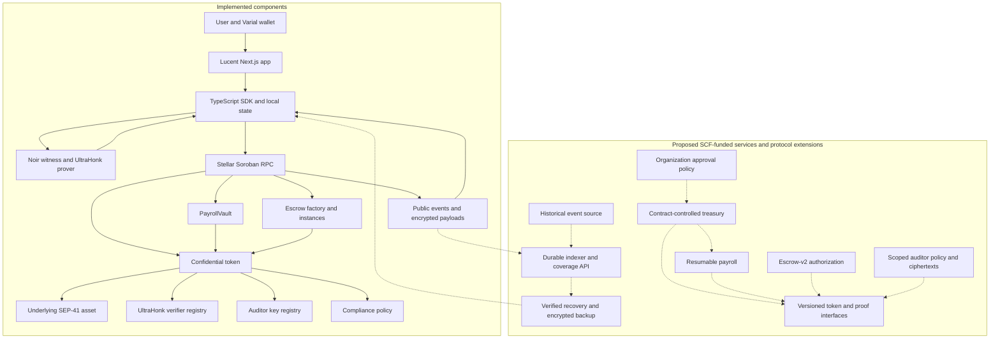

# SCF #46 Technical Architecture

**Reviewer guide — 10 November 2026.** Lucent is an experimental confidential-payments application on **Stellar Testnet**. This page distinguishes the implementation already in the repository from the **proposed SCF-funded development**. Proposed interfaces and circuit names below describe a target design, not deployed APIs or completed milestones.

The source baseline is [`139f146` in ToluLabs/Lucent](https://github.com/ToluLabs/Lucent/tree/139f146). This page does not claim an independent security audit, production readiness, a deployed full-history service, user traction, or new successful Testnet transactions. Public deployment configuration establishes configured contract addresses, not evidence that every workflow has successfully executed against them.

[Return to the documentation homepage](README.md).

## 1. Implementation status at a glance

| Area | Implemented in the current codebase | Proposed SCF-funded improvement |
| --- | --- | --- |
| Confidential token | Soroban wrapper around OpenZeppelin's experimental confidential-token implementation; SEP-41 backing asset; separate spendable and receiving commitments; registration, deposit, merge, transfer and withdrawal. | Versioned contract-controlled accounts and stronger authorization binding for escrow and organizational payments. |
| Proof system | Browser/Node UltraHonk proving, Soroban verification-key registry and on-chain verification for proof-carrying operations. | New circuits and verifier entries for new authorization, payroll commitments and auditor scopes; reproducible artifact releases and stronger key governance. |
| Escrow | Factory plus isolated instances; payout preflight checks, release/refund proofs and a delivery/dispute/timeout state machine. | Escrow-v2 authorization that does not depend on a depositor discarding a funding-time secret. |
| History and recovery | RPC event replay, optional indexer client, indexer service scaffolding and verified in-memory recovery. | Deployed historical backfill with explicit coverage checks, scalable queries and encrypted portable state backups. |
| Payroll | Employer-authorized templates and atomic runs of individual confidential transfers. | Bounded, resumable payroll chunks with run-bound payment commitments and duplicate-payment prevention. |
| Organizations | Single-employer workflow and separate administrative roles for existing registries/compliance. | Organization treasury authorization, threshold approvals, roles, policy versions and auditable execution. |
| Auditor encryption | Auditor public-key registry and sender/recipient ciphertext channels; current app registers accounts under the configured demo auditor ID. | Cryptographically bound organization/purpose/epoch scopes and explicit access/rotation policies. |
| Payment proofs | Recipient and sender selective-disclosure circuits, JSON exchange and client-side verification against independently resolved events. | Versioned integration envelope, mandatory artifact identity and stronger network/request binding for portable receipts. |
| SDK | TypeScript crypto, witness construction, proving, RPC, state, payroll, escrow, auditor and disclosure modules used by the app. | Stable integration interfaces, recovery and approval APIs, deployment manifests, examples and compatibility tests. |

**Privacy boundary today:** transfer amounts are encrypted and balances are commitments; sender/recipient addresses, timing and transaction metadata remain public. Deposit and withdrawal amounts are public. Authorized auditor channels reveal covered values. Payroll employee lists and escrow participants/state are public contract data. This is amount confidentiality, not transaction anonymity.

## 2. Current Stellar architecture



Solid connections show existing code paths. Dashed connections show proposed development; the diagram does not assert those services are deployed. The existing indexer scaffolding is discussed separately below.

### Commitments, encryption and proof verification

An account stores two Grumpkin Pedersen commitments, `C = v·G + r·H`: spendable and receiving. Public deposits and incoming confidential transfers credit receiving; `merge` adds receiving into spendable and resets receiving. Transfers and withdrawals update spendable with a proof of the required relations. **Registration, transfer and withdrawal carry proofs; deposit and merge do not require the same proof generation flow.**

The SDK uses Grumpkin ECDH and domain-separated Poseidon2 masking for confidential event payloads and auditor channels. It mirrors the circuit's field encodings, domain separators and sponge conventions. Noir witness execution and the `bb.js` UltraHonk backend produce proofs off-chain; Soroban contracts verify rather than generate proofs. The prover uses the **Keccak transcript** expected by the verifier backend. These details must remain synchronized across SDK, compiled circuits, verification keys and contracts.

The verifier contract stores keys by circuit type and restricts registration/updates to a manager role. A malicious or incorrect verification-key update is a soundness risk. The current contract is not an immutable-key or timelocked governance deployment. Token compliance configuration and account freezing are separately admin-controlled; an allowlist policy is available. Administrative access is not equivalent to an organization's payment-approval system.

Sources: [token](https://github.com/ToluLabs/Lucent/blob/139f146/contracts/token/src/lib.rs), [verifier](https://github.com/ToluLabs/Lucent/blob/139f146/contracts/verifier/src/lib.rs), [dependency versions](https://github.com/ToluLabs/Lucent/blob/139f146/contracts/Cargo.toml), [crypto](https://github.com/ToluLabs/Lucent/tree/139f146/packages/sdk/src/crypto), [prover](https://github.com/ToluLabs/Lucent/blob/139f146/packages/sdk/src/proving/prover.ts).

### Current payment data flow

1. The browser connects Varial on the configured Stellar Testnet network. A deployment-bound signed message derives confidential keys; the current app caches key material and balance openings in browser storage.
2. The SDK reconstructs openings from available events and checks that the resulting commitments match on-chain account commitments. The UI blocks confidential spending when this verification fails.
3. For a transfer, the SDK reads the recipient's registered viewing key and the required auditor keys, prepares the private witness and generates an UltraHonk proof locally. Secret keys and plaintext transfer amounts are not submitted as ordinary plaintext transaction fields.
4. The wallet approves the transaction. Soroban executes the token operation and verifier checks against contract-sourced public inputs; state changes and encrypted event payloads become the recovery/disclosure inputs.
5. The recipient synchronizes credits and merges receiving before spending. Local optimistic updates after confirmed operations are reconciled with events and on-chain commitments.

Browser compromise or an injected script can expose local secrets. A wallet signature does not replace historical balance data: regenerating the same keys after clearing storage is not a guarantee of complete balance recovery.

Sources: [wallet orchestration](https://github.com/ToluLabs/Lucent/blob/139f146/packages/app/lib/wallet.ts), [key derivation](https://github.com/ToluLabs/Lucent/blob/139f146/packages/app/lib/derive-key.ts), [state engine](https://github.com/ToluLabs/Lucent/blob/139f146/packages/sdk/src/state/engine.ts).

## 3. Proposed escrow-v2 authorization

### Existing behavior and gap

The current factory creates a dedicated Soroban contract address for each escrow. Funding prepares registration and transfer inputs, verifies release and refund proofs in separate calls, and only then atomically registers, transfers and merges. The token's payout preflight checks bind both branches to the prepared funded commitment and require a zero remaining value; changing preparation invalidates both stored approvals. Settlement does not merge unsolicited later credits into the frozen spendable balance.

However, the funding client generates the escrow's confidential secret to construct the payout proofs. The documented custody model relies on that client discarding it. Existing payout preflight and state-machine tests **do not eliminate that trust assumption**.

### Proposed components, interactions and data flow

Introduce an explicit **contract-controlled confidential account mode** in a versioned token. Registration binds the account to an escrow contract and authorization policy. Funding binds the incoming commitment to an escrow identifier and immutable payout policy. The escrow state machine selects the allowed release/refund branch, then invokes a dedicated settlement endpoint.

A proposed `EscrowSettlement` circuit proves conservation, valid recipient encryption, required auditor encryption and the permitted remaining value, with public inputs binding the escrow contract, current commitment, branch, recipient and settlement nonce. The token reconstructs these inputs from state and the authorized invocation. Possession of a funding-time secret or valid alternative proof must not substitute for authorization from the escrow contract. General spending/delegation entry points must not bypass this account mode.

Payout proofs can remain prepared before funding where compatible with the new binding. Settlement witness/proof availability must be explicit; contracts cannot generate proofs or safely store a plaintext spending secret. New token/instance/factory versions and verification keys require a versioned deployment and explicit migration plan. Existing instances do not acquire v2 guarantees automatically.

### Security assumptions and tests

Assume Soroban authorization semantics, correct circuit constraints and conservation, and the configured dispute/timeout policy. Do not assume honest deletion of client secrets. Test retained-secret attempts through **every** token spending path; forged or cross-escrow branches; wrong recipient/nonce/commitment; replay; unauthorized nested invocation; stale proofs; partial payouts; unsolicited credits; rollback on verifier failure; timeout/dispute races; and recovery when a proof is unavailable. Run real-proof Testnet settlement tests after mocked-verifier contract tests. Record execution resources and transaction sizes before choosing payload boundaries.

Sources for the existing implementation: [instance](https://github.com/ToluLabs/Lucent/blob/139f146/contracts/escrow-instance/src/instance.rs), [trust caveat](https://github.com/ToluLabs/Lucent/blob/139f146/contracts/escrow-instance/src/lib.rs), [token payout preflight](https://github.com/ToluLabs/Lucent/blob/139f146/contracts/token/src/escrow.rs), [escrow tests](https://github.com/ToluLabs/Lucent/blob/139f146/contracts/escrow-instance/src/test.rs).

## 4. Proposed historical indexing and recovery

### Existing behavior and gap

The SDK combines recent RPC events with an optional indexer for older history. `packages/indexer` contains a Goldsky pipeline definition, Postgres schema and a Cloudflare Worker read API; these files are **implementation scaffolding, not proof of a deployed, correctly backfilled service**. The checked-in pipeline's token filter differs from the current app deployment and must be reconciled before deployment.

RPC event retention is finite, commonly about seven days on the configured service. A lost browser cache can therefore leave missing inputs for balance reconstruction. The current `rebuild()` replays into memory and saves only if **both** balance commitments match the chain. A failed rebuild preserves the previous cache; it cannot manufacture unavailable history. A maximum indexed ledger alone does not demonstrate gap-free coverage.

### Proposed components, interactions and data flow

1. Configure a historical Stellar event source for the exact network, token contract and deployment ledger; verify that the provider can actually supply the required old range before promising recovery.
2. Backfill successful contract events into durable storage, then ingest the live tail. Retain canonical ledger/transaction/operation/event coordinates, schema version and deployment identity. Deduplicate idempotently and preserve execution order, including multiple events in one ledger.
3. Track **contiguous coverage ranges**, gaps, backfill completion and source freshness separately from the highest observed ledger. Expose bounded, paginated account/contract/run queries rather than requiring every client to scan the whole deployment.
4. The SDK joins the historical range to the RPC tail at a checked boundary, rejects gaps/incomplete responses and rebuilds candidate state. Only commitment-verified state becomes spendable local state.
5. Add authenticated-encrypted, versioned backup export/import for local openings and cursors. Bind backups to network, token, account and schema; decrypt locally and reverify against the chain. A stale backup still needs every subsequent event. Recovery-key loss and passphrase entropy remain user risks; no server receives plaintext spending/viewing keys.

This first indexing/backup milestone needs service, schema, ingestion, SDK and UI changes, **not a new payment circuit**. Any later on-chain recovery checkpoint or witness-encryption protocol requires a separate privacy and circuit review. An indexer started today without historical backfill does not recover yesterday's missing events outside RPC retention.

### Security assumptions and tests

An indexer is an availability and data-integrity dependency, not authority to set balances. Matching commitments prevent accepting incorrect reconstructed openings, but do not prove the completeness of an activity statement. Test missing/out-of-order/duplicate events, same-ledger ordering, boundary overlap, ingestion outages, stalled backfill, deployment changes, backup tampering/wrong password/wrong account, and restore on a fresh browser after simulated retention loss. Compare indexed events to independently fetched RPC data where ranges overlap. If older source history cannot be obtained, report the account as unrecoverable from available data rather than marking it empty.

Sources: [hybrid event source](https://github.com/ToluLabs/Lucent/blob/139f146/packages/sdk/src/chain/event-source.ts), [state engine](https://github.com/ToluLabs/Lucent/blob/139f146/packages/sdk/src/state/engine.ts), [indexer](https://github.com/ToluLabs/Lucent/tree/139f146/packages/indexer), [pipeline](https://github.com/ToluLabs/Lucent/blob/139f146/packages/indexer/goldsky/pipeline-testnet.yaml), [recovery regressions](https://github.com/ToluLabs/Lucent/blob/139f146/packages/sdk/test/state-recovery.mjs).

## 5. Proposed scalable confidential payroll

### Existing behavior and gap

`PayrollVault` is an orchestrator: the employer retains funds and proves individual transfers; the vault loops through the employee list inside one atomic `execute_run`. Salary figures remain client-side. `fund_run` records an employer assertion; **it does not reserve funds or cryptographically prove that a run is fully funded**. The current app also discovers templates/runs through counts and reads. No unlimited batch size, production throughput or organization approval capability is claimed.

### Proposed components, interactions and data flow

Create a versioned payroll run manifest with a run ID, payer, network/token, policy epoch and a commitment root for ordered recipient/payment leaves. Salary commitments must use proper blinding; an ordinary unsalted hash of a low-entropy salary is not confidentiality. The employer/organization approves this manifest, then workers or the client prepare **bounded chunks** of proofs against the current payer state.

A proposed payroll transfer circuit binds the paid amount to its authorized leaf commitment and recipient, together with run ID and leaf index. The contract validates membership and an on-chain paid-index bitmap/nullifier before executing each chunk atomically. Progress is persisted per run and exposed through indexed queries. Failed chunks can be retried against fresh state; already paid leaves cannot execute twice. Cancellation can stop unpaid leaves only. **A multi-transaction run is resumable, not globally atomic.**

Changes include payroll contract state, manifest encoding, membership validation, SDK sequencing and a new/extended transfer circuit plus matching verifier keys. The initial model can keep employer-held funds, but must label them unreserved; a future treasury budget reservation needs separately proven accounting. Browser workers and bounded proving concurrency improve responsiveness without assuming that independent proofs against the same stale spendable commitment can settle in parallel.

### Security assumptions and tests

Test root/recipient/amount substitution, duplicate leaves, reordered chunks, replay after cancellation, unauthorized execution, stale balance proofs, competing spends, insufficient funds, partial completion and resume after client failure. Benchmark actual Soroban CPU, memory, ledger read/write bytes, fees and transaction size over increasing employee counts. Publish measured safe chunk sizes and failure boundaries; no throughput target is presented here as achieved.

Source: [PayrollVault](https://github.com/ToluLabs/Lucent/blob/139f146/contracts/payroll/src/lib.rs), [contract tests](https://github.com/ToluLabs/Lucent/blob/139f146/contracts/payroll/src/test.rs), [SDK payroll](https://github.com/ToluLabs/Lucent/blob/139f146/packages/sdk/src/chain/payroll.ts).

## 6. Proposed organization-level approvals

### Existing behavior and gap

Current payroll mutations require the employer's authorization. Registry manager roles and compliance administration do not provide employee roles, threshold payment approval or a multi-user treasury. Those business features are proposed.

### Proposed components, interactions and data flow

Add an organization policy/treasury contract with members, roles, thresholds, policy epochs and expiring proposals. The initiating client constructs a canonical manifest containing network/token identity, treasury, destination or payroll root, action type, nonce, expiry and policy version. Authorized reviewers inspect the confidential details through an explicitly shared encrypted manifest and approve its digest using Stellar authorization. Public storage contains commitments and approval state, not plaintext salaries.

Once the threshold is met, the treasury authorizes **only** the exact approved Soroban invocation and consumes the nonce atomically. UI approval records alone are insufficient. A contract-controlled token account mode must prevent a single confidential-secret holder bypassing policy through another spending endpoint. Integrate this with escrow-v2's authorization work; ordinary wallet-owned token accounts must not be advertised as policy-enforced organization treasuries.

Contract changes include the policy/treasury, token authorization binding and payroll integration. Circuit changes are required wherever the approved manifest/amount commitment is not already constrained by the payment proof; a contract-controlled spending circuit must separate witness knowledge from organizational authority. No shared master secret should be sent to a backend or every member merely to make approvals work.

### Security assumptions and tests

Assume the configured threshold is trusted, signers secure their wallets, and members can independently inspect what they approve. Test below-threshold execution, duplicate approvals, role revocation, policy changes invalidating pending proposals, signature/invocation substitution, expired/reused nonces, cross-network replay and attempts to bypass the treasury with a valid proof. Test all nested authorization paths and concurrent proposal execution on Soroban. Specify liveness procedures for lost signers and intentionally unavailable approvers.

Existing authorization sources: [payroll](https://github.com/ToluLabs/Lucent/blob/139f146/contracts/payroll/src/lib.rs), [compliance admin](https://github.com/ToluLabs/Lucent/blob/139f146/contracts/token/src/lib.rs), [auditor manager](https://github.com/ToluLabs/Lucent/blob/139f146/contracts/auditor/src/lib.rs).

## 7. Proposed scoped auditor encryption

### Existing behavior and gap

The auditor registry stores public keys by auditor ID. Transfer ciphertexts provide a sender channel (amount and post-transfer spendable balance) and recipient channel (amount and transfer blinding). The current app uses a common configured demo auditor ID. Someone holding a corresponding secret can decrypt covered channels; merely filtering the console does not restrict that power. Registry rotation cannot revoke access to historical ciphertext already encrypted to an old key.

### Proposed components, interactions and data flow

Introduce a versioned scope record binding organization, purpose, permitted disclosure type and key epoch to an auditor public key. The client resolves the authorized scope, constructs scoped ciphertexts, and proves their linkage to the same payment amount. The token resolves the scope/key from authorized policy and reconstructs the circuit inputs; it must reject a client selecting an arbitrary auditor or using a scope from another organization.

Design minimal disclosure channels explicitly: an amount-only audit must not silently include the current sender balance or the recipient's opening randomness. Scope IDs and encryption domains must be cryptographically bound, not just labels in an API. New registry/policy fields, ciphertext/event versions, circuit constraints, verification keys, SDK decryptors and migration rules are required. Multiple simultaneous auditors would need an explicit costed design; it is not assumed to be a free extension of the existing two channels.

### Security assumptions and tests

Audit key holders can retain anything already decrypted. Rotation protects future epochs only; retroactive secrecy is not promised. Test cross-scope and cross-epoch decryption, unauthorized key replacement, omitted/substituted auditor channels, ciphertext/amount inconsistency, malformed points, migration between versions and independent sender/recipient policies. Circuit negative tests must show that removing required audit disclosure invalidates a payment proof.

Sources: [auditor registry](https://github.com/ToluLabs/Lucent/blob/139f146/contracts/auditor/src/lib.rs), [decryption channels](https://github.com/ToluLabs/Lucent/blob/139f146/packages/sdk/src/auditor/decrypt.ts), [transfer witness](https://github.com/ToluLabs/Lucent/blob/139f146/packages/sdk/src/witness/transfer.ts).

## 8. Proposed portable payment proofs

### Existing behavior and gap

Sender and recipient selective-disclosure circuits already produce a proof of a particular transfer amount encrypted to a designated disclosure recipient and request nonce. JSON request/bundle transport exists. Verification resolves the event and relevant account keys independently, constructs the public inputs, verifies UltraHonk, then decrypts the disclosed amount. The app supplies a pinned verification key; the SDK's pin parameter is optional and must be supplied by security-conscious integrations.

The current wallet can rederive the outgoing transfer ephemeral scalar for transfers built with its deterministic scheme; legacy/nonmatching transfers may not support sender disclosure. These proofs are off-chain and do not require a disclosure transaction. They are not universally readable public receipts, and verification depends on obtaining the referenced event/account data.

### Proposed components, interactions and data flow

Define a versioned receipt envelope with network/token identity, event coordinates, circuit/artifact identity, disclosure role and recipient/request context. A receiving application issues and retains its own nonce, key and expiry; the holder returns the proof envelope. The verifier resolves authoritative inputs through RPC or verified historical infrastructure, enforces the artifact allowlist and request binding, and records nonce consumption where one-time acceptance is required.

Envelope metadata alone is not cryptographic binding: explicit network, expiry, application audience or additional business claims require new circuit public inputs/domain separation if those claims are to be proved. Reuse existing amount-disclosure circuits only for the statements they actually constrain. Neither SDK JSON packaging nor a successful ZK check proves an invoice was paid in a legal/business sense without an agreed application policy.

Core transport/validation tooling can be added without token changes. Extending the proven statement requires versioned disclosure circuits, pinned artifacts and verifier support. Add invoice/receipt references as blinded commitments only after specifying who may learn them and how they bind to the payment.

### Security assumptions and tests

Test wrong recipient/request nonce, substituted event/account, unsupported artifact, wrong network/token, malformed envelopes, expired/consumed requests and corrupted proofs/ciphertexts. Retest sender and recipient roles separately, including retained-history loss and a fresh third-party verifier. Publish interoperable fixtures with expected accept/reject outcomes; do not claim offline verification without a separately specified authenticated chain-data mechanism.

Sources: [disclosure types](https://github.com/ToluLabs/Lucent/blob/139f146/packages/sdk/src/disclosure/types.ts), [verification protocol](https://github.com/ToluLabs/Lucent/blob/139f146/packages/sdk/src/disclosure/verify.ts), [circuits and pinned artifacts](https://github.com/ToluLabs/Lucent/tree/139f146/packages/disclosure), [app verifier](https://github.com/ToluLabs/Lucent/blob/139f146/packages/app/app/verify/verify-panel.tsx).

## 9. Proposed developer SDK integrations

**Existing foundation:** `@lucent/sdk` supplies crypto, witnesses, proof generation, XDR payloads, RPC submission, state stores, payroll/escrow reads and actions, auditor decryption and disclosure verification. The app adapts Varial through `@stellar/freighter-api`; the package name remains unchanged by the wallet rebrand. The SDK is currently a private workspace package, not a claim of a supported public registry release.

**Proposed components and data flow:** publish versioned integration interfaces for deployment discovery, signer adapters, verified balances/recovery, payroll manifests, organization proposals, scoped audit access and receipt verification. A developer loads a versioned deployment manifest, attaches a user signer, obtains verified state, prepares an operation/proof and submits the exact authorized invocation. Read-only reporting services use indexed ciphertext/events without receiving users' spending secrets. Keep proving/local storage APIs usable without an application backend.

**Required changes:** SDK types, typed recovery/coverage errors, cancellation/progress APIs, deployment/circuit compatibility checks and minimal examples. Each new contract/circuit version must have an explicit SDK compatibility mapping. An SDK-only wrapper cannot implement missing on-chain authorization. Key handling and envelope protocols need documented security contracts before public release.

**Testing:** compile and execute examples against the supported package interfaces, test Browser/Node decoding parity and BigInt precision, verify version mismatch failures, and run integration fixtures for each new contract/circuit version. Use disposable Testnet accounts for signer/authorization and real-proof tests. Test documentation examples without embedding keys, credentials or deployment-admin secrets.

Sources: [SDK exports](https://github.com/ToluLabs/Lucent/blob/139f146/packages/sdk/src/index.ts), [package manifest](https://github.com/ToluLabs/Lucent/blob/139f146/packages/sdk/package.json), [Varial adapter](https://github.com/ToluLabs/Lucent/blob/139f146/packages/app/lib/freighter.ts).

## 10. Validation and evidence policy

The commands below exist in this source baseline. They are reproducible entry points, **not a statement that every command has passed during this documentation publication**. Install the repository's pinned dependencies/toolchains first. Real-proof tests require their circuit artifacts and compatible proving backend; contract/disclosure compilation requires the upstream dependencies referenced in the repository.

```sh
pnpm install --frozen-lockfile
pnpm build:sdk
pnpm --filter @lucent/sdk typecheck
pnpm --filter @lucent/sdk test:fast
pnpm test:forms
pnpm --filter @lucent/app typecheck
pnpm --filter @lucent/app build
pnpm test:ui
pnpm --filter @lucent/app test:browser
cargo test --manifest-path contracts/Cargo.toml
```

For additional real-proof/network validation, the repository provides:

```sh
pnpm test:sdk
pnpm e2e
pnpm e2e:disclosure
```

The E2E scripts submit Testnet transactions and need funded test accounts, usable deployment configuration and compatible contract interfaces. Do not run them against real funds or treat a unit test with mocked verification as proof of live settlement. Contract WASM is built with `pnpm build:contracts` (which invokes Stellar's contract build path); this is distinct from `cargo test`.

For each funded milestone, publish a reproducible evidence bundle: source commit, network, deployment and artifact identifiers, command/tool versions, public transaction hashes for successful live cases, negative cases and measured resource/latency results. Redact secrets and private business data. Report failed or skipped cases explicitly. No projected payroll capacity, successful v2 escrow settlement, production audit, or completed historical recovery is asserted by this page.

## 11. Delivery dependencies and acceptance gates

| Proposed workstream | Dependency and acceptance gate |
| --- | --- |
| History and recovery | Validate historical-source availability; backfill the correct deployment; demonstrate gap detection and commitment-verified restore after storage loss. |
| Contract-controlled authorization and escrow-v2 | Review every spending path; publish new circuit/contract versions; prove retained-secret bypasses fail and real-proof settlement works on Testnet. |
| Organization approvals | Specify threshold/policy semantics and bind approval to exact token invocation and confidential manifest; demonstrate bypass/replay rejection. |
| Scalable payroll | Build on approved manifests and compatible token interfaces; demonstrate resumable, bounded chunks with no duplicate salaries and publish measured limits. |
| Scoped auditor encryption | Specify privacy scope and rotation/migration semantics; demonstrate circuit-enforced channel binding and cross-scope rejection. |
| Portable proofs and SDK | Freeze versioned artifacts/interfaces; publish third-party verifier fixtures, tested examples and compatibility documentation. |

All workstreams remain subject to cryptographic review, Soroban resource limits and explicit migration planning. External security review and remediation are prerequisites to handling real value, not an audit already completed or guaranteed by publication. The existing public GitBook address and Git Sync configuration are retained; this is an additional technical submission page, not a documentation-site rebuild.
