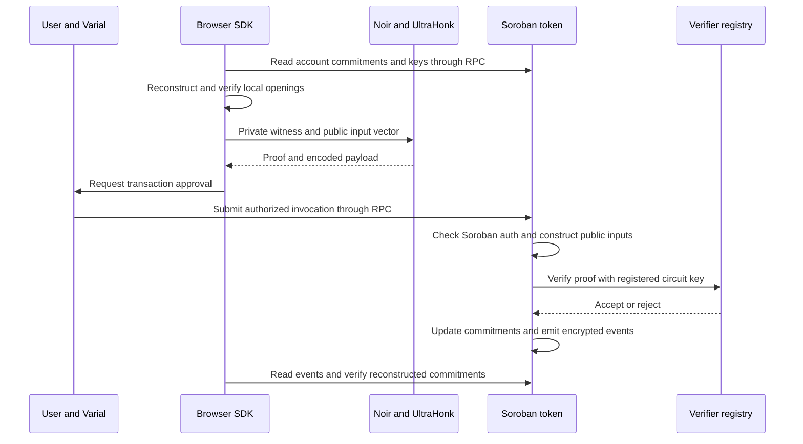
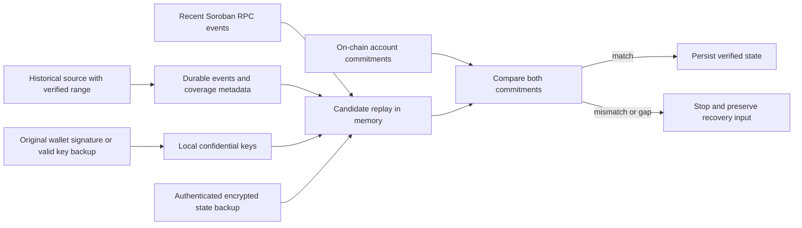
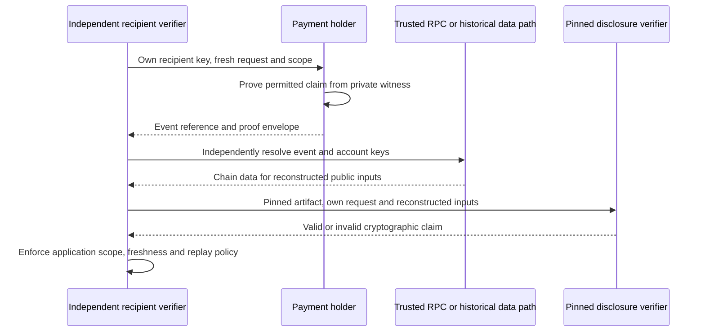
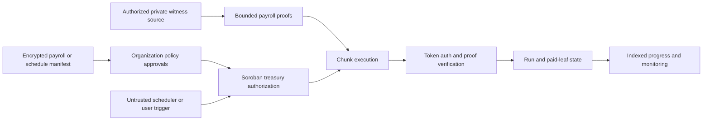

# SCF #46 Technical Architecture

## 1. Executive Technical Summary

**Last checked: 10 November 2026.** We're building Lucent to make confidential payments usable on Stellar. We've implemented an experimental Stellar Testnet application using Soroban contracts, Grumpkin commitments and UltraHonk proofs. We applied to the **SCF #46 Open Track Build Award for $70,000** to turn that foundation into more reliable payment infrastructure and developer tooling.

This page explains what we've built, what is actually deployed, and what we plan to build with the award. The source snapshot is [`00c2270`](https://github.com/ToluLabs/Lucent/tree/00c2270); our live deployment checks are linked separately. Interfaces and circuit names marked proposed are still designs, not available APIs.

**Where the funded work ends:** SCF has confirmed that our final funded milestone can conclude with a **production-ready Stellar Testnet implementation**, including security validation, monitoring, user testing and Mainnet readiness. **We are not allocating SCF funding to Mainnet deployment.** Production readiness is our target for that milestone; our current implementation is experimental and unaudited.

**Our funding schedule:** **Tranche 0 is $7,000 upon award acceptance**. The remaining **$63,000** is split across Tranches 1–3: **$14,000, $21,000 and $28,000**. Together, they make up the **$70,000 request**. Tranche 0 is the initial acceptance payment, not an extra technical workstream.

### Status labels

- **Implemented and deployed on Testnet:** public contract WASM was retrievable at the manifest addresses; five wrapper artifacts match the checked-in binaries. This establishes code presence/artifact identity, not successful live execution of every feature.
- **Implemented locally, not deployed as the current compatible interface:** token escrow preflight and the newer four-step escrow instance flow. The configured token and manifest-recorded instance artifact differ from current checked-in binaries.
- **Partial/experimental:** the unaudited payment/proof stack; local recovery; optional indexing scaffolding; browser disclosure workflows and a private workspace SDK. Full historical recovery and live indexer operation are not established.
- **Proposed SCF-funded development:** all organization, recurring payroll, invoicing, scoped auditing, threshold-proof and other improvements explicitly marked proposed below.

| Area | Implemented in the current codebase | Proposed SCF-funded improvement |
| --- | --- | --- |
| Confidential token | Soroban wrapper around OpenZeppelin's experimental confidential-token implementation; SEP-41 backing asset; separate spendable and receiving commitments; registration, deposit, merge, transfer and withdrawal. | Review existing Soroban authorization and add policy/context binding where required for escrow and organization payments. |
| Proof system | Browser/Node UltraHonk proving, Soroban verification-key registry and on-chain verification for proof-carrying operations. | New circuits and verifier entries for new authorization, payroll commitments and auditor scopes; reproducible artifact releases and stronger key governance. |
| Escrow | Factory and legacy instance WASM are present on Testnet. The newer source preflight/four-step funding flow is implemented locally but incompatible with the configured token/instance versions; see deployment evidence below. | Escrow-v2 authorization hardening and witness-custody review, with tests against every spending/delegation path. |
| History and recovery | RPC event replay, optional indexer client, indexer service scaffolding and verified in-memory recovery. | Deployed historical backfill with explicit coverage checks, scalable queries and encrypted portable state backups. |
| Payroll | Employer-authorized templates and atomic runs of individual confidential transfers. | Bounded, resumable payroll chunks with run-bound payment commitments and duplicate-payment prevention. |
| Organizations | Single-employer workflow and separate administrative roles for existing registries/compliance. | Organization treasury authorization, threshold approvals, roles, policy versions and auditable execution. |
| Auditor encryption | Auditor public-key registry and sender/recipient ciphertext channels; current app registers accounts under the configured demo auditor ID. | Cryptographically bound organization/purpose/epoch scopes and explicit access/rotation policies. |
| Payment proofs | Recipient and sender selective-disclosure circuits, JSON exchange and client-side verification against independently resolved events. | Versioned integration envelope, mandatory artifact identity and stronger network/request binding for portable receipts. |
| SDK | TypeScript crypto, witness construction, proving, RPC, state, payroll, escrow, auditor and disclosure modules used by the app. | Stable integration interfaces, recovery and approval APIs, deployment manifests, examples and compatibility tests. |

**Privacy boundary today:** transfer amounts are encrypted and balances are commitments; sender/recipient addresses, timing and transaction metadata remain public. Deposit and withdrawal amounts are public. Authorized auditor channels reveal covered values. Payroll employee lists and escrow participants/state are public contract data. This is amount confidentiality, not transaction anonymity.

[Documentation homepage](README.md) · [Public deployment-check evidence](https://github.com/ToluLabs/Lucent/blob/main/docs/evidence/scf-46-architecture-audit.json).

## 2. Existing System Architecture

`packages/app` is the Next.js client and Varial signer adapter; `packages/sdk` builds witnesses, encodes calls, proves and reconstructs state. Soroban executes the token and orchestration contracts. `packages/disclosure` contains the separate sender/recipient disclosure circuits and pinned artifacts. `packages/indexer` contains the optional ingestion/API scaffolding, not a demonstrated full-history deployment.

### Observed deployment, not assumed source parity

On 10 November 2026, we used read-only `getContractWasmByContractId` calls to retrieve the configured token, verifier, auditor, payroll, factory and policy WASM. We compared SHA-256 hashes and found matching repository artifacts for **verifier, auditor, payroll, factory and policy**. The **token did not match**. We also confirmed through read-only simulations that the registered register/withdraw/transfer verification-key bytes match the repository VK files, and auditor ID 0 matches the manifest public key. This does not prove circuit soundness or live proof acceptance. The separately fetched, manifest-recorded instance WASM also **did not match** the current instance binary; this does not identify the version of every existing instance or prove the factory's stored WASM selection.

The configured token's public interface lacks `verify_escrow_payout`. The manifest-recorded instance exports `store_payout_proofs`, not the source's newer two preflight methods. Consequently, the newer source escrow flow is not a compatible deployed feature at those manifest references. We did not upgrade contracts or submit live payments during these checks.

| Configured contract | Public Testnet reference | Audit conclusion |
| --- | --- | --- |
| Confidential token | [CACKE…XAABF](https://stellar.expert/explorer/testnet/contract/CACKEFUKVPBGDJM6Z4NOTY3H44MUMJDYIRNBLH6MDFN3QUSFWENXAABF) | WASM present; differs from repository artifact; escrow preflight missing. |
| Verifier | [CAL32…STYN](https://stellar.expert/explorer/testnet/contract/CAL32C7RZ5AB4IIYJBAH6XHPFZPFMUGMJ4ZDYQPOA3X7LX6EOJCZSTYN) | WASM artifact and three registered payment VKs match; live proof acceptance is not demonstrated by that comparison. |
| Auditor | [CB6FO…RUQ](https://stellar.expert/explorer/testnet/contract/CB6FOYTSTRCCBYZGOZJVNY5RGCT5LXEEPV5D2BZK7O3LMKSLLLQ7QRUQ) | WASM present and artifact matches. |
| PayrollVault | [CCO6…PVVS](https://stellar.expert/explorer/testnet/contract/CCO6LMKLPJCWUQYDEHOY2EHYPITYOGT6JPKXIRHDXKEUYTXQEAJPPVVS) | WASM present and artifact matches; no new live run demonstrated. |
| Escrow factory | [CCGJ…2XS](https://stellar.expert/explorer/testnet/contract/CCGJ5XEZDFSKJSLWEO7D22KZXOSPRNWE4R3RFO4SQBWPQ5RZ3WK7I2XS) | Factory WASM matches; that alone does not validate its token/instance compatibility. |
| Compliance policy | [CB6Z…UME](https://stellar.expert/explorer/testnet/contract/CB6Z7YIWYMKU3QUALYBJZMJEF72QRKBPFOCDHECPD3V5DCIRMU674UME) | WASM present and artifact matches; active policy configuration is not inferred from code presence. |

The underlying SEP-41 asset and addresses come from the [redacted app manifest](https://github.com/ToluLabs/Lucent/blob/00c2270/packages/app/lib/deployment.json). A manifest, explorer link or demo is not a substitute for a reproducible successful transaction plus matching deployed code/key versions.

## 3. Cryptographic Design

An account stores two Grumpkin Pedersen commitments, `C = v·G + r·H`: spendable and receiving. Public deposits and incoming confidential transfers credit receiving; `merge` adds receiving into spendable and resets receiving. Transfers and withdrawals update spendable with a proof of the required relations. **Registration, transfer and withdrawal carry proofs; deposit and merge do not require the same proof generation flow.**

The SDK uses Grumpkin ECDH and domain-separated Poseidon2 masking for confidential event payloads and auditor channels. It mirrors the circuit's field encodings, domain separators and sponge conventions. Noir witness execution and the `bb.js` UltraHonk backend produce proofs off-chain; Soroban contracts verify rather than generate proofs. The prover uses the **Keccak transcript** expected by the verifier backend. These details must remain synchronized across SDK, compiled circuits, verification keys and contracts.

The verifier contract stores keys by circuit type and restricts registration/updates to a manager role. A malicious or incorrect verification-key update is a soundness risk. The current contract is not an immutable-key or timelocked governance deployment. Token compliance configuration and account freezing are separately admin-controlled; an allowlist policy is available. Administrative access is not equivalent to an organization's payment-approval system.

Sources: [token](https://github.com/ToluLabs/Lucent/blob/00c2270/contracts/token/src/lib.rs), [verifier](https://github.com/ToluLabs/Lucent/blob/00c2270/contracts/verifier/src/lib.rs), [dependency versions](https://github.com/ToluLabs/Lucent/blob/00c2270/contracts/Cargo.toml), [crypto](https://github.com/ToluLabs/Lucent/tree/00c2270/packages/sdk/src/crypto), [prover](https://github.com/ToluLabs/Lucent/blob/00c2270/packages/sdk/src/proving/prover.ts).

### Exact proof inputs and authentication

The compiled ABI and witness builders expose **5 registration**, **15 withdrawal** and **24 transfer** public field elements. Each point occupies two fields:

| Circuit | Ordered input groups |
| --- | --- |
| Register | `Y`, `PVK`, `addr_f`. |
| Withdraw | `C_spend`, `Y`, `addr_f`, sender auditor key, public amount `a`, `C_spend_new`, `sigma`, encrypted balance checkpoint, `R_e`, auditor checkpoint. |
| Transfer | `C_spend`, `Y`, recipient `PVK`, `addr_f`, recipient/sender auditor keys, `C_spend_new`, `C_tx`, `R_e`, encrypted amount, encrypted balance checkpoint, `sigma`, four auditor ciphertext fields. |

The token reconstructs current commitments, registered keys, deployment field and auditor keys from contract state; callers provide candidate output commitments/ciphertexts/proof. The proof constrains their consistency. **Cryptographic proof validity and Soroban authorization are separate checks:** the pinned upstream trait requires owner authentication for register, merge, transfer, withdraw and delegation setup; delegated spending requires the authorized spender. No blanket proof-only spending claim is made.

`addr_f` binds viewing-key derivation/proof inputs to the token address; Poseidon domain tags separate uses. Explicit network/audience/business-operation binding is not supplied merely by attaching metadata. Current-state commitment binding normally rejects stale spending proofs after state changes; do not advertise a universal spent-proof/nullifier registry or application-level replay policy. Transaction/account authorization and new business nonces must be analyzed separately.

Grumpkin's coordinate field is BN254 `F_r`; its scalar/group-order field is BN254 `F_p`. Homomorphic blinding accumulation uses the group order (`fpAdd`), not coordinate-field addition. Generator independence/discrete-log hardness, correct curve/point checks, circuit soundness, the proving system's setup/SRS assumptions and the Keccak transcript are security assumptions, not guarantees established by unit tests.

Sources: [register witness](https://github.com/ToluLabs/Lucent/blob/00c2270/packages/sdk/src/witness/register.ts), [withdraw witness](https://github.com/ToluLabs/Lucent/blob/00c2270/packages/sdk/src/witness/withdraw.ts), [transfer witness](https://github.com/ToluLabs/Lucent/blob/00c2270/packages/sdk/src/witness/transfer.ts), [compiled circuit ABIs](https://github.com/ToluLabs/Lucent/tree/00c2270/packages/sdk/circuits), [pinned upstream authorization](https://github.com/OpenZeppelin/stellar-contracts/blob/539968f158e0d779f584de2821090f715a3b25e1/packages/tokens/src/confidential/mod.rs), [state-sourced public inputs](https://github.com/OpenZeppelin/stellar-contracts/blob/539968f158e0d779f584de2821090f715a3b25e1/packages/tokens/src/confidential/storage.rs), [group arithmetic](https://github.com/ToluLabs/Lucent/blob/00c2270/packages/sdk/src/crypto/field.ts).

## 4. Soroban Contract Architecture

| Existing contract | Responsibility and authority boundary |
| --- | --- |
| Confidential token | SEP-41 backing, commitments and proof-carrying operations; uses inherited owner/spender authorization plus compliance hooks. Underlying assets must have the expected exact-transfer semantics. The new escrow preflight helper is read-only, not a grant to move funds. |
| Verifier registry | Stores verification keys by circuit type; manager can register/update them. Wrong/malicious keys compromise soundness. Immutable keys or multisig/timelock governance are not currently established. |
| Auditor registry | Manager-controlled auditor key registration/rotation; account auditor IDs select encryption keys. This is not organization-scoped disclosure consent. |
| PayrollVault | Employer-authenticated templates and run states; sequential transfers within one atomic transaction. No salary reservation is created by `fund_run`. |
| Escrow factory/instance | Deploy isolated contract-address accounts; instance lifecycle chooses release/refund/dispute/timeout outcomes. Source and manifest versions must be coordinated. |
| Compliance policy | Admin-controlled allowlist and token freeze/configuration controls; not identity verification, legal KYC certification or organizational payment approvals. |

The confidential primitive is consumed from OpenZeppelin's experimental branch, resolved at **`539968f158e0d779f584de2821090f715a3b25e1`** in `Cargo.lock`; the UltraHonk Soroban backend resolves to Nethermind **`661db07200f890b1bd9a7349ed787c70a706dd12`**. Lucent's wrappers/orchestration and SDK must remain compatible with that protocol/artifact set. Source, lockfile and binary parity are distinct pieces of provenance.

Sources: [contract workspace](https://github.com/ToluLabs/Lucent/blob/00c2270/contracts/Cargo.toml), [dependency lockfile](https://github.com/ToluLabs/Lucent/blob/00c2270/contracts/Cargo.lock), [verifier](https://github.com/ToluLabs/Lucent/blob/00c2270/contracts/verifier/src/lib.rs), [auditor](https://github.com/ToluLabs/Lucent/blob/00c2270/contracts/auditor/src/lib.rs), [policy](https://github.com/ToluLabs/Lucent/blob/00c2270/contracts/policy/src/lib.rs), [escrow helper](https://github.com/ToluLabs/Lucent/blob/00c2270/contracts/token/src/escrow.rs).

## 5. Payment and Verification Flows

1. The browser connects Varial on the configured Stellar Testnet network. A deployment-bound signed message derives confidential keys; the current app caches key material and balance openings in browser storage.
2. The SDK reconstructs openings from available events and checks that the resulting commitments match on-chain account commitments. The UI blocks confidential spending when this verification fails.
3. For a transfer, the SDK reads the recipient's registered viewing key and the required auditor keys, prepares the private witness and generates an UltraHonk proof locally. Secret keys and plaintext transfer amounts are not submitted as ordinary plaintext transaction fields.
4. The wallet approves the transaction. Soroban executes the token operation and verifier checks against contract-sourced public inputs; state changes and encrypted event payloads become the recovery/disclosure inputs.
5. The recipient synchronizes credits and merges receiving before spending. Local optimistic updates after confirmed operations are reconciled with events and on-chain commitments.

Browser compromise or an injected script can expose local secrets. A wallet signature does not replace historical balance data: regenerating the same keys after clearing storage is not a guarantee of complete balance recovery.

Sources: [wallet orchestration](https://github.com/ToluLabs/Lucent/blob/00c2270/packages/app/lib/wallet.ts), [key derivation](https://github.com/ToluLabs/Lucent/blob/00c2270/packages/app/lib/derive-key.ts), [state engine](https://github.com/ToluLabs/Lucent/blob/00c2270/packages/sdk/src/state/engine.ts).



**Operation visibility:** deposit uses a public `i128` amount and zero-blinded credit; merge is homomorphic and authorized; transfer amount remains encrypted; withdrawal has a public amount bound into its proof. Public deposits/withdrawals can correlate otherwise confidential activity. Proving latency, transaction fees, storage restoration and network failure remain distinct lifecycle stages; a confirmation timeout does not establish failure.

**Existing payroll:** the employer proves transfers against sequential intermediate balances, submits the ordered vector to `execute_run`, and all transfers commit or revert together. This scales only within measured Soroban limits. The employer role does not automatically confer audit decryption: auditor ciphertext access depends on the registered auditor keys/IDs. The current app uses its configured common demo auditor ID.

**Existing disclosure:** the verifier issues a recipient key/nonce request; the holder builds a sender or recipient proof; the verifier independently resolves the event/account inputs, checks the selected circuit/artifact and decrypts the disclosed amount. This is off-chain validation, not another transfer or a proof of real-world invoice performance.

## 6. Proposed SCF-Funded Architecture

Every subsection in this section is **proposed**, even where it reuses existing source. Completion is demonstrated on Stellar Testnet; no Mainnet deployment is included. Section 10 maps each submitted budget item to measurable acceptance gates.

### 6.1 Reliable historical infrastructure

The $5,000 Tranche 1 workstream reuses the hybrid event client, state engine and indexer scaffolding. Its data flow, service/schema changes, secret-recovery boundaries and adversarial tests are specified in section 8. Completion requires historical coverage plus verified fresh-browser recovery, not merely deploying an API with today's events.

### 6.2 Secure confidential escrow v2

#### Existing behavior and gap

The current factory creates a dedicated Soroban contract address for each escrow. Funding prepares registration and transfer inputs, verifies release and refund proofs in separate calls, and only then atomically registers, transfers and merges. The token's payout preflight checks bind both branches to the prepared funded commitment and require a zero remaining value; changing preparation invalidates both stored approvals. Settlement does not merge unsolicited later credits into the frozen spendable balance.

The funding client generates the instance's confidential secret and therefore learns its witness material. Existing source comments recommend discarding it, which is a custody/privacy concern. **However, the pinned upstream token also calls `from.require_auth()` for transfer/withdraw, and owner authorization is required to create a delegation. A confidential secret or valid proof alone does not authorize a Soroban contract address.** We have not demonstrated a secret-only authorization bypass. Mock-authorized tests do not establish that a bypass exists or that all authorization paths are safe. Treat retained-witness misuse as a threat to test, not a proven theft route.

The source preflight flow above is **local implementation**, not the currently configured live interface. Read-only WASM inspection found no `verify_escrow_payout` export on the configured token, and the manifest-recorded instance WASM exports the older `store_payout_proofs` interface rather than `prepare_funding`/`store_payout_proof`. The current app funding sequence must not be reported as demonstrated against that pair.

#### Proposed components, interactions and data flow

We'll start with the existing Soroban authorization checks and review every invocation and delegation path. A proposed hardening design is an explicit **contract-controlled confidential account mode** in a versioned token; whether this new mode/circuit is necessary rather than a smaller authorization change remains a design decision. Registration binds the account to an escrow contract and authorization policy. Funding binds the incoming commitment to an escrow identifier and immutable payout policy. The escrow state machine selects the allowed release/refund branch, then invokes a dedicated settlement endpoint.

A proposed `EscrowSettlement` circuit proves conservation, valid recipient encryption, required auditor encryption and the permitted remaining value, with public inputs binding the escrow contract, current commitment, branch, recipient and settlement nonce. The token reconstructs these inputs from state and the authorized invocation. Possession of a funding-time secret or valid alternative proof must not substitute for authorization from the escrow contract. General spending/delegation entry points must not bypass this account mode.

Payout proofs can remain prepared before funding where compatible with the new binding. Settlement witness/proof availability must be explicit; contracts cannot generate proofs or safely store a plaintext spending secret. Changed token/instance/factory interfaces require a coordinated Testnet deployment and explicit migration plan; new verification keys are required only if circuits change. Existing instances do not acquire v2 guarantees automatically.

#### Security assumptions and tests

Assume Soroban authorization semantics, correct circuit constraints and conservation, and the configured dispute/timeout policy. Do not assume honest deletion of client secrets. Test retained-secret attempts through **every** token spending path; forged or cross-escrow branches; wrong recipient/nonce/commitment; replay; unauthorized nested invocation; stale proofs; partial payouts; unsolicited credits; rollback on verifier failure; timeout/dispute races; and recovery when a proof is unavailable. Run real-proof Testnet settlement tests after mocked-verifier contract tests. Record execution resources and transaction sizes before choosing payload boundaries.

Sources for the existing implementation: [instance](https://github.com/ToluLabs/Lucent/blob/00c2270/contracts/escrow-instance/src/instance.rs), [trust caveat](https://github.com/ToluLabs/Lucent/blob/00c2270/contracts/escrow-instance/src/lib.rs), [token payout preflight](https://github.com/ToluLabs/Lucent/blob/00c2270/contracts/token/src/escrow.rs), [escrow tests](https://github.com/ToluLabs/Lucent/blob/00c2270/contracts/escrow-instance/src/test.rs).

**Acceptance:** a compatible versioned Testnet token/instance/factory set; documented invocation/witness threat model; passing direct and delegated bypass/replay tests and real-proof release/refund/dispute/timeout evidence. Do not equate mocked preflight verification with live-proof settlement.

### 6.3 Scalable confidential payroll

#### Existing behavior and gap

`PayrollVault` is an orchestrator: the employer retains funds and proves individual transfers; the vault loops through the employee list inside one atomic `execute_run`. Salary figures remain client-side. `fund_run` records an employer assertion; **it does not reserve funds or cryptographically prove that a run is fully funded**. The current app also discovers templates/runs through counts and reads. No unlimited batch size, production throughput or organization approval capability is claimed.

#### Proposed components, interactions and data flow

We'll add a versioned payroll run manifest with a run ID, payer, network/token, policy epoch and a commitment root for ordered recipient/payment leaves. Salary commitments must use proper blinding; an ordinary unsalted hash of a low-entropy salary is not confidentiality. The employer/organization approves this manifest, then workers or the client prepare **bounded chunks** of proofs against the current payer state.

A proposed payroll transfer circuit binds the paid amount to its authorized leaf commitment and recipient, together with run ID and leaf index. The contract validates membership and an on-chain paid-index bitmap/nullifier before executing each chunk atomically. Progress is persisted per run and exposed through indexed queries. Failed chunks can be retried against fresh state; already paid leaves cannot execute twice. Cancellation can stop unpaid leaves only. **A multi-transaction run is resumable, not globally atomic.**

Changes include payroll contract state, manifest encoding, membership validation, SDK sequencing and a new/extended transfer circuit plus matching verifier keys. The initial model can keep employer-held funds, but must label them unreserved; a future treasury budget reservation needs separately proven accounting. Browser workers and bounded proving concurrency improve responsiveness without assuming that independent proofs against the same stale spendable commitment can settle in parallel.

#### Security assumptions and tests

Test root/recipient/amount substitution, duplicate leaves, reordered chunks, replay after cancellation, unauthorized execution, stale balance proofs, competing spends, insufficient funds, partial completion and resume after client failure. Benchmark actual Soroban CPU, memory, ledger read/write bytes, fees and transaction size over increasing employee counts. Publish measured safe chunk sizes and failure boundaries; no throughput target is presented here as achieved.

Source: [PayrollVault](https://github.com/ToluLabs/Lucent/blob/00c2270/contracts/payroll/src/lib.rs), [contract tests](https://github.com/ToluLabs/Lucent/blob/00c2270/contracts/payroll/src/test.rs), [SDK payroll](https://github.com/ToluLabs/Lucent/blob/00c2270/packages/sdk/src/chain/payroll.ts).

**Acceptance:** publish tested safe chunk sizes and resource measurements; prove every authorized leaf can execute at most once across retry/cancel/resume scenarios; demonstrate multiple bounded chunks on Testnet without claiming whole-run atomicity.

### 6.4 Organization workspaces and enforceable approvals

#### Existing behavior and gap

Current payroll mutations require the employer's authorization. Registry manager roles and compliance administration do not provide employee roles, threshold payment approval or a multi-user treasury. Those business features are proposed.

#### Proposed components, interactions and data flow

We'll build an organization policy/treasury contract with members, roles, thresholds, policy epochs and expiring proposals. The initiating client constructs a canonical manifest containing network/token identity, treasury, destination or payroll root, action type, nonce, expiry and policy version. Authorized reviewers inspect the confidential details through an explicitly shared encrypted manifest and approve its digest using Stellar authorization. Public storage contains commitments and approval state, not plaintext salaries.

Once the threshold is met, the treasury authorizes **only** the exact approved Soroban invocation and consumes the nonce atomically. UI approval records alone are insufficient. The token/treasury integration must enforce Soroban contract authorization on every spending/delegation route; the existing `require_auth` checks are a starting point. A new explicit account mode is a proposed option, not evidence that the current token permits a secret-only bypass. Integrate this with escrow-v2's authorization work; ordinary wallet-owned token accounts must not be advertised as policy-enforced organization treasuries.

Contract changes include the policy/treasury, token authorization binding and payroll integration. Circuit changes are required wherever the approved manifest/amount commitment is not already constrained by the payment proof. Whether a new contract-controlled spending circuit is needed must follow the authorization review; witness knowledge and organizational authority must remain separate. No shared master secret should be sent to a backend or every member merely to make approvals work.

#### Security assumptions and tests

Assume the configured threshold is trusted, signers secure their wallets, and members can independently inspect what they approve. Test below-threshold execution, duplicate approvals, role revocation, policy changes invalidating pending proposals, signature/invocation substitution, expired/reused nonces, cross-network replay and attempts to bypass the treasury with a valid proof. Test all nested authorization paths and concurrent proposal execution on Soroban. Specify liveness procedures for lost signers and intentionally unavailable approvers.

Existing authorization sources: [payroll](https://github.com/ToluLabs/Lucent/blob/00c2270/contracts/payroll/src/lib.rs), [compliance admin](https://github.com/ToluLabs/Lucent/blob/00c2270/contracts/token/src/lib.rs), [auditor manager](https://github.com/ToluLabs/Lucent/blob/00c2270/contracts/auditor/src/lib.rs).

**Acceptance:** unauthorized/below-threshold execution and mutated/expired proposals fail; valid policy-bound approval executes exactly its authorized Testnet action. An organization UI, a shared confidential key or registry admin role alone does not satisfy this deliverable.

### 6.5 Recurring confidential payroll

**What we'll build:** we'll build on the bounded payroll run/manifest and organization policy, adding a versioned schedule record with period identifier, due window, end/revocation condition, approved budget/recipient root and consumed-period state. Proposed functions are schedule creation/revocation and bounded period-run execution; exact interfaces remain to be frozen.

**Flow and Stellar interaction:** a client or untrusted off-chain scheduler notices a due window from Soroban ledger time, prepares or obtains the current-state proofs, and submits a normal authorized Testnet transaction. The contract validates the schedule/policy epoch, exact period/manifest, time window and duplicate-period marker before routing a chunk. Soroban contracts do not wake themselves or generate proofs. Reusing the approved-leaf circuit needs period/schedule binding where not already constrained; recurrence is not just a cron job calling today's unrestricted `execute_run`.

**Security/open decision:** an unattended prover cannot be assumed to have private witnesses securely. Decide whether users pre-authorize/provide bounded proof material or a scoped proving executor is trusted with restricted data; document revocation, witness access and the need to refresh stale commitment proofs. No custodial master key is silently assigned to the scheduler. Insufficient funds, missing witnesses or scheduler downtime must fail/retry visibly, not imply a salary was paid.

**Acceptance/tests:** two successive periods and duplicate triggers on Testnet; late/missed windows, revoked schedules, policy changes, stale proofs, competing spends and restarted scheduler. Each period/leaf is paid at most once. Automatic execution/liveness is not claimed before the private-witness design passes review.

### 6.6 Confidential invoicing and reconciliation

**What we'll build:** we'll reuse encrypted records, recipient checking and selective-disclosure circuits. Add a versioned, locally encrypted invoice record with issuer/payee, network/token, amount commitment, invoice identifier, status and settlement evidence. A proposed minimal Soroban invoice registry can store issuer-authorized commitment/status and prevent duplicate acknowledgment; whether on-chain registration is necessary for the first version remains an explicit design decision.

**Flow and verification:** the issuer creates/signs an invoice commitment using fresh blinding, the payer pays through the confidential token, and a dedicated invoice-bound receipt proves that the resolved payment amount/recipient satisfies that invoice commitment. Reconciliation verifies that proof against the invoice record and independent chain event. The existing amount-disclosure circuit alone does **not** bind arbitrary invoice metadata. A new disclosure circuit/artifact is needed for that claim. If settlement status is updated on-chain, use an authenticated token callback or independently verified invoice-bound proof—not an arbitrary caller-supplied transaction hash.

**Security:** a salted commitment avoids guessing low-entropy invoice amounts, but public parties/timing remain visible. A valid payment proof does not establish delivery of goods, tax treatment or an invoice's legal validity. Exact-payment versus partial/overpayment rules and invoice cancellation/duplicate-payment behavior must be specified; no unsupported accounting guarantees are implied.

**Acceptance/tests:** a real Testnet payment reconciles to the correct encrypted invoice; wrong amount/recipient/token/invoice, duplicate claim, forged issuer, cancellation and tampered proof are rejected or explicitly flagged. No plaintext invoice business record or payment secret is required in the indexer.

### 6.7 Organization-scoped auditor access and key management

#### Existing behavior and gap

The auditor registry stores public keys by auditor ID. Transfer ciphertexts provide a sender channel (amount and post-transfer spendable balance) and recipient channel (amount and transfer blinding). Our current app uses a common configured demo auditor ID. Someone holding a corresponding secret can decrypt covered channels; merely filtering the console does not restrict that power. Registry rotation cannot revoke access to historical ciphertext already encrypted to an old key.

#### Proposed components, interactions and data flow

We plan to add a versioned scope record binding organization, purpose, permitted disclosure type and key epoch to an auditor public key. The client resolves the authorized scope, constructs scoped ciphertexts, and proves their linkage to the same payment amount. The token resolves the scope/key from authorized policy and reconstructs the circuit inputs; it must reject a client selecting an arbitrary auditor or using a scope from another organization.

Design minimal disclosure channels explicitly: an amount-only audit must not silently include the current sender balance or the recipient's opening randomness. Scope IDs and encryption domains must be cryptographically bound, not just labels in an API. New registry/policy fields, ciphertext/event versions, circuit constraints, verification keys, SDK decryptors and migration rules are required. Multiple simultaneous auditors would need an explicit costed design; it is not assumed to be a free extension of the existing two channels.

#### Security assumptions and tests

Audit key holders can retain anything already decrypted. Rotation protects future epochs only; retroactive secrecy is not promised. Test cross-scope and cross-epoch decryption, unauthorized key replacement, omitted/substituted auditor channels, ciphertext/amount inconsistency, malformed points, migration between versions and independent sender/recipient policies. Circuit negative tests must show that removing required audit disclosure invalidates a payment proof.

Sources: [auditor registry](https://github.com/ToluLabs/Lucent/blob/00c2270/contracts/auditor/src/lib.rs), [decryption channels](https://github.com/ToluLabs/Lucent/blob/00c2270/packages/sdk/src/auditor/decrypt.ts), [transfer witness](https://github.com/ToluLabs/Lucent/blob/00c2270/packages/sdk/src/witness/transfer.ts).

**Acceptance:** demonstrate separate organization/purpose/epoch scopes with required ciphertext binding; record successful authorized and failing cross-scope disclosure tests, rotation behavior and historical-key handling on Testnet. Rotation must not be described as retroactively revoking ciphertext access.

### 6.8 Threat model and on-chain monitoring

**What we'll build:** we'll turn section 7's boundaries into a versioned threat model and a read-only monitor fed by public Soroban configuration, authorization/state-change events and indexer coverage/health. Alert on unexpected code/key/policy/admin changes, failed ingestion, incompatible deployments and repeated settlement failures. No new payment circuit is inherently needed; event/API changes may be needed if the required observables are not exposed.

**Security:** monitors cannot prevent an authorized malicious key update, decrypt every user's activity or repair missing witnesses. Protect monitoring credentials/configuration, authenticate alert destinations and redact user/business secrets. Define alert thresholds, stale-data indicators and incident ownership; do not publish private infrastructure details.

**Acceptance/tests:** replay/simulate code/key/policy-change and ingestion-outage fixtures, show an alert and a recovery/runbook response, and measure detection delay. Confirm that ordinary user data and auditor secrets are not sent to telemetry. No live production monitoring deployment is claimed today.

### 6.9 Portable confidential payment and invoice proofs

#### Existing behavior and gap

Sender and recipient selective-disclosure circuits already produce a proof of a particular transfer amount encrypted to a designated disclosure recipient and request nonce. JSON request/bundle transport exists. Verification resolves the event and relevant account keys independently, constructs the public inputs, verifies UltraHonk, then decrypts the disclosed amount. The app supplies a pinned verification key; the SDK's pin parameter is optional and must be supplied by security-conscious integrations.

A fresh nonce binds a proof to a request, but the SDK does not maintain a consumed-request registry or enforce request expiry. Re-verifying the same bundle against the same retained request is not prevented automatically.

The current wallet can rederive the outgoing transfer ephemeral scalar for transfers built with its deterministic scheme; legacy/nonmatching transfers may not support sender disclosure. These proofs are off-chain and do not require a disclosure transaction. They are not universally readable public receipts, and verification depends on obtaining the referenced event/account data.

#### Proposed components, interactions and data flow

We'll define a versioned receipt envelope with network/token identity, event coordinates, circuit/artifact identity, disclosure role and recipient/request context. A receiving application issues and retains its own nonce, key and expiry; the holder returns the proof envelope. The verifier resolves authoritative inputs through RPC or verified historical infrastructure, enforces the artifact allowlist and request binding, and records nonce consumption where one-time acceptance is required.

Envelope metadata alone is not cryptographic binding: explicit network, expiry, application audience or additional business claims require new circuit public inputs/domain separation if those claims are to be proved. Reuse existing amount-disclosure circuits only for the statements they actually constrain. Neither SDK JSON packaging nor a successful ZK check proves an invoice was paid in a legal/business sense without an agreed application policy.

Core transport/validation tooling can be added without token changes. Extending the proven statement requires versioned disclosure circuits, pinned artifacts and verifier support. Add invoice/receipt references as blinded commitments only after specifying who may learn them and how they bind to the payment.

#### Security assumptions and tests

Test wrong recipient/request nonce, substituted event/account, unsupported artifact, wrong network/token, malformed envelopes, expired/consumed requests and corrupted proofs/ciphertexts. Retest sender and recipient roles separately, including retained-history loss and a fresh third-party verifier. Publish interoperable fixtures with expected accept/reject outcomes; do not claim offline verification without a separately specified authenticated chain-data mechanism.

Sources: [disclosure types](https://github.com/ToluLabs/Lucent/blob/00c2270/packages/sdk/src/disclosure/types.ts), [verification protocol](https://github.com/ToluLabs/Lucent/blob/00c2270/packages/sdk/src/disclosure/verify.ts), [circuits and pinned artifacts](https://github.com/ToluLabs/Lucent/tree/00c2270/packages/disclosure), [app verifier](https://github.com/ToluLabs/Lucent/blob/00c2270/packages/app/app/verify/verify-panel.tsx).

**Acceptance:** publish versioned schemas and test vectors for payment and invoice claims; a separate reference verifier validates a real Testnet event and rejects wrong-chain, wrong-invoice, wrong-request and unsupported-artifact bundles. Invoice claims depend on section 6.6's additional binding; they are not already covered by the current amount-only circuit.

### 6.10 Threshold proofs and scoped disclosure authorization

**What we'll build:** we plan to support confidential **predicate proofs**, such as proving an event amount is at least a stated threshold without revealing the amount. It is distinct from m-of-n organization transaction approvals. The first supported predicate (payment amount or a fresh balance statement) and its freshness policy remain to be selected; aggregates are not assumed in scope.

**Components/data flow:** a verifier issues its own key/nonce, threshold, audience, scope and expiry under an authenticated request policy. The holder resolves the referenced event/current commitment and generates a new Noir proof binding that evidence, predicate and allowed audience/request. Range/comparison constraints must prevent field wraparound and invalid negative/out-of-range values. The verifier independently resolves the evidence, uses a pinned predicate-specific VK and enforces scope, expiry and nonce consumption before accepting the result.

**Changes and security:** extend disclosure circuits/artifact IDs, request/bundle schemas, SDK policy checks and reference-verifier state. Token changes are unnecessary for purely off-chain disclosure; on-chain use would require a separately specified verifier integration. An authorization policy cannot retract information already disclosed, and expiry metadata alone cannot cryptographically revoke an already issued proof. Balance predicates need an explicit ledger/state freshness rule; historical-event predicates need authenticated historical data.

**Acceptance/tests:** true/false and exact-boundary comparisons, malicious thresholds/ranges, stale balance, event substitution, cross-scope/audience/network replay, expired/reused requests and wrong VKs. Publish positive/negative fixtures and Testnet-backed verification evidence without exposing the hidden amount or opening.

### 6.11 Developer SDK and reference integration

We'll build on the SDK we already use in Lucent; section 9 sets out the interface work. Completion includes a separate reference integration that consumes versioned deployment/artifact manifests, verified state and payment/invoice/predicate proofs against Testnet; compilation alone is not external interoperability evidence.

### 6.12 Security validation, operational hardening and Testnet pilots

**What we'll build:** we'll build on the contract, circuit, SDK and browser suites, deployment-version checks, monitoring and recovery services. Add threat-driven authorization/cryptographic tests, reviewed release artifacts, incident/rollback and backup/restore drills, and consent-based Testnet pilot records. Any code/circuit changes resulting from findings must be revalidated with the corresponding VK/deployment versions.

**What we'll deliver:** documented security review and remediation evidence, no unresolved critical issues under the agreed review process, monitored compatible Testnet deployment, reproducible pilot transactions and user-reported failure handling. Record tester methodology without equating page visits with verified customers. No audit already completed or pilot traction is claimed. Funded deployment ends on **Stellar Testnet**, with a documented Mainnet-readiness assessment only; Mainnet deployment receives no SCF allocation.

## 7. Security Model and Privacy Guarantees

| Boundary/threat | Existing behavior and residual risk | Proposed verification/control |
| --- | --- | --- |
| Public ledger and correlation | Addresses, timing, payroll employee lists, escrow state/participants, public deposit/withdrawal amounts and metadata remain visible. Authorized auditor channels reveal covered values. | State amount confidentiality precisely; test event payloads and prevent new invoice/organization records leaking plaintext salaries/business data. |
| Browser/wallet compromise | Confidential keys/openings are cached locally without application-level encryption. Same-wallet key derivation needs the original account and exact deployment-bound message; legacy random keys need a real backup. | Reviewed key handling, encrypted backups and fresh-device tests. XSS/malicious extensions or a compromised build remain serious risks. |
| Authorization vs proof knowledge | Owner/spender authentication is enforced by the pinned token trait; a proof alone does not authenticate a contract address. Delegation is an additional spending surface. | Audit exact nested invocation trees, account/treasury authority, allowance setup/revocation and retained-witness attacks with real auth, not only `mock_all_auths`. |
| Relayer/indexer/RPC | A submitter can censor/delay; an indexer can omit/reorder/fabricate data. Local openings must match chain commitments. RPC/indexer responses are trusted network inputs, not automatic cryptographic light-client proofs. | Independent source comparisons, gap detection, chain-state authentication/version checks, retry/idempotency and signed authorization bound to exact requests. |
| Proof system and key governance | Depends on circuit completeness, curve/domain/encoding correctness, SRS/prover/verifier assumptions and correct registered VKs. Managers can change keys. | Negative constraints, cross-implementation parity, artifact pinning and reviewed release/key governance. No independent security audit is evidenced by this repository. |
| Auditor compromise/rotation | A shared demo auditor key can decrypt both covered channels. Rotation cannot erase old ciphertext or knowledge; changing a registry key may affect old prepared proofs. | Organization/purpose/epoch binding, historical-key policy and settlement/rotation compatibility tests; do not implement scope as a console filter. |
| Operations and liveness | Resource limits, state archival/TTL, incompatible contracts, stale proofs, key loss and service downtime can block execution/recovery. | Bounded work, explicit coverage/version health, renewal/restoration procedures, drills and incident runbooks. No guaranteed recovery after loss of all required secret material. |

Disclosure verifiers must obtain event/accounts from their own trusted chain-data path, not accept holder-supplied public inputs as truth. The current app pins disclosure artifacts, but SDK callers can omit `pinnedVk`; the proposed stable integration must make its trust-anchor policy explicit. A request nonce provides context binding; **the current SDK does not consume requests or enforce expiry automatically**. A valid amount proof does not establish identity, business delivery or universal legal settlement.

## 8. Infrastructure, Indexing and Recovery

### Existing behavior and gap

The SDK combines recent RPC events with an optional indexer for older history. `packages/indexer` contains a Goldsky pipeline definition, Postgres schema and a Cloudflare Worker read API; these files are **implementation scaffolding, not proof of a deployed, correctly backfilled service**. The checked-in pipeline's token filter differs from the current app deployment and must be reconciled before deployment.

RPC event retention is finite, commonly about seven days on the configured service. A lost browser cache can therefore leave missing inputs for balance reconstruction. The current `rebuild()` replays into memory and saves only if **both** balance commitments match the chain. A failed rebuild preserves the previous cache; it cannot manufacture unavailable history. A maximum indexed ledger alone does not demonstrate gap-free coverage.

### Proposed components, interactions and data flow

1. Configure a historical Stellar event source for the exact network, token contract and deployment ledger; verify that the provider can actually supply the required old range before promising recovery.
2. Backfill successful contract events into durable storage, then ingest the live tail. Retain canonical ledger/transaction/operation/event coordinates, schema version and deployment identity. Deduplicate idempotently and preserve execution order, including multiple events in one ledger.
3. Track **contiguous coverage ranges**, gaps, backfill completion and source freshness separately from the highest observed ledger. Expose bounded, paginated account/contract/run queries rather than requiring every client to scan the whole deployment.
4. The SDK joins the historical range to the RPC tail at a checked boundary, rejects gaps/incomplete responses and rebuilds candidate state. Only commitment-verified state becomes spendable local state.
5. Add authenticated-encrypted, versioned backup export/import for local openings and cursors. Bind backups to network, token, account and schema; decrypt locally and reverify against the chain. A stale backup still needs every subsequent event. Recovery-key loss and passphrase entropy remain user risks; no server receives plaintext spending/viewing keys.

This first indexing/backup milestone needs service, schema, ingestion, SDK and UI changes, **not a new payment circuit**. Any later on-chain recovery checkpoint or witness-encryption protocol requires a separate privacy and circuit review. An indexer started today without historical backfill does not recover yesterday's missing events outside RPC retention.

### Security assumptions and tests

An indexer is an availability and data-integrity dependency, not authority to set balances. Matching commitments prevent accepting incorrect reconstructed openings, but do not prove the completeness of an activity statement. Test missing/out-of-order/duplicate events, same-ledger ordering, boundary overlap, ingestion outages, stalled backfill, deployment changes, backup tampering/wrong password/wrong account, and restore on a fresh browser after simulated retention loss. Compare indexed events to independently fetched RPC data where ranges overlap. If older source history cannot be obtained, report the account as unrecoverable from available data rather than marking it empty.

Sources: [hybrid event source](https://github.com/ToluLabs/Lucent/blob/00c2270/packages/sdk/src/chain/event-source.ts), [state engine](https://github.com/ToluLabs/Lucent/blob/00c2270/packages/sdk/src/state/engine.ts), [indexer](https://github.com/ToluLabs/Lucent/tree/00c2270/packages/indexer), [pipeline](https://github.com/ToluLabs/Lucent/blob/00c2270/packages/indexer/goldsky/pipeline-testnet.yaml), [recovery regressions](https://github.com/ToluLabs/Lucent/blob/00c2270/packages/sdk/test/state-recovery.mjs).

### Secret recovery is a separate dependency

Historical events recover **data needed to reconstruct openings**, not an arbitrary lost spending/viewing secret. Our current app can rederive keys from the same supported wallet's signature over the unchanged network/token-bound message; that does not recover older randomly generated keys, a lost Stellar wallet, or historical balance data. An encrypted backup must distinguish wallet/secret recovery from cached openings/cursors and must be authenticated and deployment-bound. An auditor key is not a replacement for user spend authorization.

Ordinary `sync()` persists its replay result; the wallet then checks commitments before displaying it as spendable. Only the explicit `rebuild()` uses the isolated candidate-and-verify-before-save path. Therefore the document does not claim that every sync provides the same atomic cache-preservation guarantee as recovery. Corrupt/absent history must remain a visible failure, not a fabricated zero balance.



**Additional coverage limit:** the current event parser/state engine recognizes the register/deposit/merge/withdraw/transfer family; inherited spender/delegation operations are not a completed browser recovery workflow. Do not enable arbitrary spender features in integrations without implementing and testing their event/accounting recovery paths. The checked-in Goldsky filter also targets a different token address, and its maximum-ledger watermark does not prove contiguous history.

## 9. Developer SDK and Integrations

**What we have:** our `@lucent/sdk` supplies crypto, witnesses, proof generation, XDR payloads, RPC submission, state stores, payroll/escrow reads and actions, auditor decryption and disclosure verification. The app adapts Varial through `@stellar/freighter-api`; the package name remains unchanged by the wallet rebrand. We currently use the SDK as a private workspace package. We haven't released a supported public package yet.

**Integration plan:** we'll publish versioned integration interfaces for deployment discovery, signer adapters, verified balances/recovery, payroll manifests, organization proposals, scoped audit access and receipt verification. A developer loads a versioned deployment manifest, attaches a user signer, obtains verified state, prepares an operation/proof and submits the exact authorized invocation. Read-only reporting services use indexed ciphertext/events without receiving users' spending secrets. Keep proving/local storage APIs usable without an application backend.

**Required changes:** SDK types, typed recovery/coverage errors, cancellation/progress APIs, deployment/circuit compatibility checks and minimal examples. Each new contract/circuit version must have an explicit SDK compatibility mapping. An SDK-only wrapper cannot implement missing on-chain authorization. Key handling and envelope protocols need documented security contracts before public release.

**Testing:** compile and execute examples against the supported package interfaces, test Browser/Node decoding parity and BigInt precision, verify version mismatch failures, and run integration fixtures for each new contract/circuit version. Use disposable Testnet accounts for signer/authorization and real-proof tests. Test documentation examples without embedding keys, credentials or deployment-admin secrets.

Sources: [SDK exports](https://github.com/ToluLabs/Lucent/blob/00c2270/packages/sdk/src/index.ts), [package manifest](https://github.com/ToluLabs/Lucent/blob/00c2270/packages/sdk/package.json), [Varial adapter](https://github.com/ToluLabs/Lucent/blob/00c2270/packages/app/lib/freighter.ts).

Stable release acceptance also requires documenting unsupported inherited-token operations, recovery/key-loss limits, chain-data trust and nonce-consumption behavior. The **reference integration** must be outside the main UI flow, use the same pinned schemas/artifacts and demonstrate both successful and adversarial payment/invoice verification on Testnet. We still need to turn the SDK we use internally into a supported developer product; the current app integration alone does not complete that work.

## 10. Tranche-to-Architecture Mapping

Our payment schedule starts with Tranche 0, the initial payment upon award acceptance; Tranches 1–3 fund the proposed technical deliverables. These are the deliverables we plan to build, not features we are presenting as complete. We'll finalize the API and circuit decisions before accepting the corresponding implementation.

| Tranche | Submitted deliverable | Amount | Architecture and measurable gate |
| --- | --- | ---: | --- |
| **0** | **Initial payment upon award acceptance** | **$7,000** | Initial payment upon accepting the award; technical deliverables follow in Tranches 1–3. |
| 1 | Durable historical indexing and account recovery | $5,000 | Sections 6.1/8: correct-deployment backfill, explicit coverage/gap checks and verified fresh-browser restore including secret prerequisites. |
| 1 | Secure confidential escrow v2 | $4,000 | Section 6.2: reviewed auth/custody design, compatible Testnet versions, bypass rejection and real-proof settlement cases. |
| 1 | Scalable confidential payroll | $5,000 | Section 6.3: bounded resumable chunks, no duplicate leaves, resource measurements and Testnet evidence. |
| **1 total** | **Reliable Confidential Payment Infrastructure** | **$14,000** | Dependencies: history availability and compatible contract/artifact set. |
| 2 | Organization workspaces and enforceable approvals | $6,000 | Section 6.4: threshold/policy-bound authorization, revocation/replay rejection and exact-invocation tests. |
| 2 | Recurring confidential payroll | $5,000 | Section 6.5: defined private-witness/scheduler design; two periods, duplicate/revocation/insufficient-funds cases. |
| 2 | Confidential invoicing and reconciliation | $4,000 | Section 6.6: invoice-to-payment proof binding; rejection of wrong/duplicate invoice evidence. |
| 2 | Organization-scoped auditor access and key management | $4,000 | Section 6.7: cryptographic scope/epoch binding and rotation/historical-data tests. |
| 2 | Threat model and on-chain monitoring | $2,000 | Section 6.8: published boundaries, simulated alerts, measured detection and response runbooks. |
| **2 total** | **Confidential Business Payments** | **$21,000** | Depends on authorization/payroll primitives and reviewed data disclosure policies. |
| 3 | Portable confidential payment and invoice proofs | $8,000 | Section 6.9: versioned envelopes, independent reference verifier and real Testnet event fixtures. |
| 3 | Threshold proofs and scoped disclosure authorization | $7,000 | Section 6.10: selected predicate/scope/freshness specification and positive/negative proof vectors. |
| 3 | Developer SDK and reference integration | $7,000 | Sections 6.11/9: compatibility manifest, tested examples and independent reference integration. |
| 3 | Security validation, operational hardening and Testnet pilots | $6,000 | Section 6.12: review/remediation, monitoring/recovery drills, documented Testnet pilot outcomes and readiness assessment. |
| **3 total** | **Programmable Verification and Testnet Readiness** | **$28,000** | **Funded deployment endpoint: Stellar Testnet. Mainnet deployment excluded.** |
| **Technical tranches 1–3** | | **$63,000** | $14,000 + $21,000 + $28,000. |
| **Total request, tranches 0–3** | | **$70,000** | $7,000 initial acceptance payment + $63,000 technical milestones. |

## 11. Testing and Verification Strategy

We ran `pnpm --filter @lucent/sdk test:fast` successfully (including witness/circuit execution parity, event pagination, recovery-cache preservation and deployment namespaces). The live indexer-parity case was **skipped** because no indexer endpoint was configured. `cargo test --manifest-path contracts/Cargo.toml --locked --offline` passed **44 tests**: policy 3, token 6, payroll 10, factory 1, instance 24. Verifier/auditor wrappers have no dedicated Rust unit tests in this run. Some contract tests mock token/proof verification and/or authorization; these are not real-proof or full-auth settlement evidence.

The read-only deployment inspection retrieved WASM/interfaces and hashes, not successful E2E payments. We have not validated new live settlement, recurring payroll, invoice/predicate proofs, deployed indexer parity or pilots in this review. We list the browser and real-proof commands below so others can reproduce them; we did not rerun those suites as part of this documentation review unless a result is separately recorded.

```sh
pnpm install --frozen-lockfile
pnpm build:sdk
pnpm --filter @lucent/sdk typecheck
pnpm --filter @lucent/sdk test:fast
pnpm test:forms
pnpm --filter @lucent/app typecheck
pnpm --filter @lucent/app build
pnpm test:ui
pnpm --filter @lucent/app test:browser
cargo test --manifest-path contracts/Cargo.toml --locked
```

Additional proving/network entry points are `pnpm test:sdk`, `pnpm e2e` and `pnpm e2e:disclosure`. The E2E scripts submit transactions, need funded disposable accounts and compatible deployment configuration; they are **not** a live E2E harness for every proposed deliverable. `pnpm build:contracts` uses Stellar's contract build path for WASM; `cargo test` is separate. Disclosure recompilation also currently depends on an external relative `stellar_confidential_lib` checkout, so clean-checkout reproducibility requires documenting/provisioning that dependency.

For each funded row, publish: source/artifact/deployment IDs; exact tested claim; tool versions; successful and failed cases; **public Testnet transaction hashes when transactions are used**; resource/latency measurements; recovery/monitoring/pilot results and unresolved findings. Never use a deployment address, mocked proof or page view as a substitute for a verified live transaction or real tester. Acceptance evidence must redact secrets and private invoices/salaries.

### Portable verification data flow



### Proposed payroll and approvals data flow



## 12. Known Limitations and Open Design Decisions

1. **Deployment:** the configured token lacks the newer escrow preflight endpoint, and the manifest-recorded instance is legacy. Freeze a compatible artifact set and record live validation before reporting that source flow as deployed.
2. **Escrow:** determine whether existing Soroban authorization plus smaller changes suffices or an explicit account mode/new settlement circuit is justified. Test all spending/delegation paths and witness-availability/rotation failures; secret possession alone is not a demonstrated authorization bypass.
3. **Recovery/indexing:** obtain the correct historical range; deploy/backfill and independently validate decoding/coverage. Lost wallet secrets or missing pre-backup events cannot be fixed merely by an indexer.
4. **Recurring payroll:** finalize how unattended current-state proofs obtain witnesses without assigning a master spending key to a keeper, and specify bounded catch-up/liveness behavior.
5. **Invoices/predicates:** finalize invoice registry/partial-payment rules, first threshold statement, circuit context binding, freshness and request-consumption policy. Current amount disclosure does not prove those extra claims.
6. **Audit keys:** freeze organization/purpose/epoch semantics, historical key handling, multi-scope costs and compatibility with pre-generated escrow proofs. Rotation is not retroactive erasure.
7. **Release/security:** we have not completed an independent security audit; reproducible source builds and circuit-to-VK derivation, external circuit checkout, browser key storage, complete delegation recovery, incident response and main review findings remain readiness gates.
8. **Funding boundary:** final funded deployment and pilots are on Testnet under our agreement with SCF; Mainnet deployment must remain outside funded work. Maintain the written agreement and tranche schedule as application records.

## 13. References and Evidence

- [Audited source snapshot](https://github.com/ToluLabs/Lucent/tree/00c2270) and [redacted deployment manifest](https://github.com/ToluLabs/Lucent/blob/00c2270/packages/app/lib/deployment.json).
- [Read-only Testnet WASM/interface/hash evidence](https://github.com/ToluLabs/Lucent/blob/main/docs/evidence/scf-46-architecture-audit.json). Reproduce with `rpc.Server.getContractWasmByContractId`, SHA-256 of returned bytes and `contract.Spec.fromWasm`; compare to the pinned repository binaries. Instance code was fetched separately by its manifest hash. Registered VKs were read with simulated `get_verification_key` calls (types 0/1/2), and auditor ID 0 with `get_key`. These calls do not sign or submit transactions. Public RPC providers can change retention/availability after the recorded check.
- [Pinned upstream authorization](https://github.com/OpenZeppelin/stellar-contracts/blob/539968f158e0d779f584de2821090f715a3b25e1/packages/tokens/src/confidential/mod.rs) and [proof public inputs/accounting](https://github.com/OpenZeppelin/stellar-contracts/blob/539968f158e0d779f584de2821090f715a3b25e1/packages/tokens/src/confidential/storage.rs); [Cargo.lock](https://github.com/ToluLabs/Lucent/blob/00c2270/contracts/Cargo.lock) records the resolved dependency revisions.
- [Token preflight tests](https://github.com/ToluLabs/Lucent/blob/00c2270/contracts/token/src/test.rs), [payroll tests](https://github.com/ToluLabs/Lucent/blob/00c2270/contracts/payroll/src/test.rs), [escrow tests](https://github.com/ToluLabs/Lucent/blob/00c2270/contracts/escrow-instance/src/test.rs), [factory test](https://github.com/ToluLabs/Lucent/blob/00c2270/contracts/escrow-factory/src/test.rs), [recovery regression tests](https://github.com/ToluLabs/Lucent/blob/00c2270/packages/sdk/test/state-recovery.mjs), [event pagination tests](https://github.com/ToluLabs/Lucent/blob/00c2270/packages/sdk/test/event-pagination.mjs).
- [Disclosure source/artifacts](https://github.com/ToluLabs/Lucent/tree/00c2270/packages/disclosure), [real-proof test entry point](https://github.com/ToluLabs/Lucent/blob/00c2270/packages/sdk/test/prove.mjs), [disclosure test entry point](https://github.com/ToluLabs/Lucent/blob/00c2270/packages/sdk/test/disclosure.mjs), [Testnet payment script](https://github.com/ToluLabs/Lucent/blob/00c2270/scripts/e2e.ts), [Testnet disclosure script](https://github.com/ToluLabs/Lucent/blob/00c2270/scripts/e2e-disclosure.ts) and [CI workflow](https://github.com/ToluLabs/Lucent/blob/00c2270/.github/workflows/ci.yml).
- [Launch demo](https://youtu.be/l7yIpmE0OqE) is a product walkthrough, not independent proof that every current deployment/version passed. [Security policy](https://github.com/ToluLabs/Lucent/blob/00c2270/SECURITY.md) states the unaudited Testnet-only status.

We will use this page and the linked evidence to track the engineering work against our SCF milestones. Our funded deployment and testing endpoint remains Stellar Testnet.

[Back to the existing documentation homepage](README.md).
